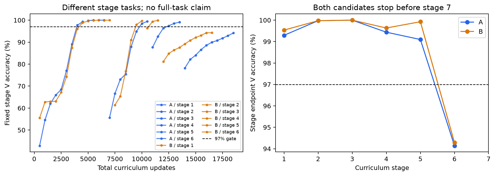
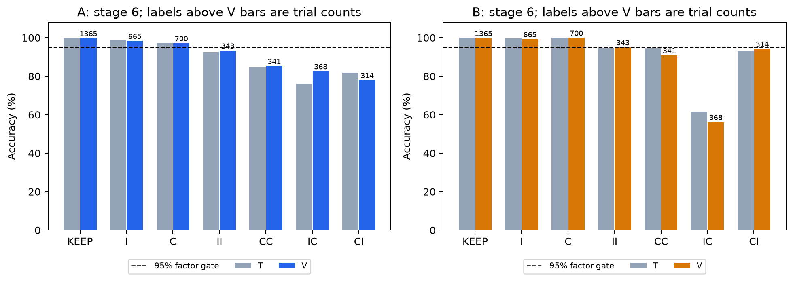
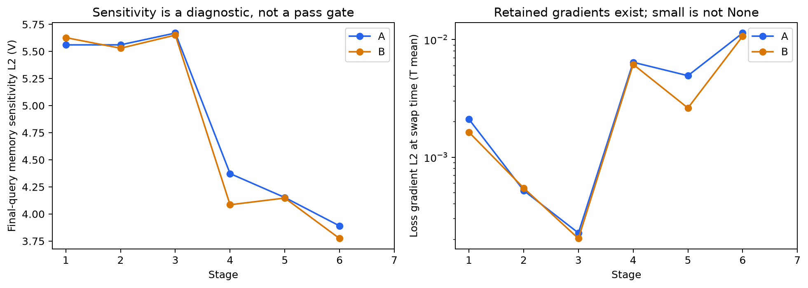

> English edition · [Frozen original](../../../../../../experiments/memory_interchange/results/v1_1/report.md) · [English index](../../../../README.md)
>
> Dates, status, execution scope and conclusions describe the original version. Commands, identifiers, data and figures retain their original definitions.

# v1.1 task-learning revision report: BLOCKED

Date: 2026-10-12 (America/Los_Angeles). This version revises task learning only, without scientific interchange/prediction experiments.

## Where learning failed

**Both prescribed candidates failed stage 6: original timing, both contexts and two-step computations with non-N count ≤2. The first five stages passed, stage 7 was not run, and the full 65-word original task has not reached TASK_READY.**

| Candidate | Stage 6 updates | T accuracy | V accuracy | V CE (nat) | V k=2 accuracy | Cumulative course updates through stage 6 |
|---|---:|---:|---:|---:|---:|---:|
| A | 5000 | 93.9209% | 94.1406% | 0.166255 | 84.9195% | 18500 |
| B | 5000 | 95.3125% | 94.2871% | 0.135206 | 83.3821% | 16500 |

Both reached the fixed stage cap of 5,000 updates. Overall V remained below 97% and some operation factors below 95%. Neither advanced speculatively; capacity, gate bias, learning rate, seeds and update caps were not expanded.

This localizes the stopping gate to two-step task learning. These data alone do not distinguish control composition, content updating or readout as the causal mechanism.

## Was learning repaired?

No input, label, effective-step-index or computation-graph bug was found in the v1.0 training entry point. The curriculum passes short readout, original-length retention, single inverse/complement and context subtasks, but does not yet repair full original-task learning.

Near-zero v1.0 interchange damage remains a diagnostic of an unlearned task, not evidence of memory interchangeability. H1/H2/H3 are untested in this version.

## T/V comparison of original models

| v1.0 capacity | Checkpoint | Step | Fixed-T accuracy | New balanced-V accuracy | Original-V accuracy | T CE | Balanced-V CE |
|---:|---|---:|---:|---:|---:|---:|---:|
| 128 | best | 10000 | 14.6484% | 15.0269% | 14.7827% | 1.944767 | 1.946783 |
| 128 | latest | 20000 | 14.9170% | 14.0991% | 14.3066% | 1.944621 | 1.946586 |
| 256 | best | 11000 | 15.0757% | 14.4653% | 14.8926% | 1.945315 | 1.946632 |
| 256 | latest | 20000 | 14.9170% | 14.0991% | 14.3066% | 1.944694 | 1.946593 |

Each of the three sets contains 8,192 trials. New T/V original-task diagnostics use seed=20261013 with balanced factor sampling. Original V retains the exact v1.0 8,192 trials, independently checked by SHA-256. Both T and V remain near 1/7=14.2857%, contradicting the account that T was learned and only new-permutation generalization failed.

For original best/latest, answer-change rates after removal/fixed shuffling of stimuli are 0 on T, balanced V and original V. Per-trial outputs, CE and strata are in `audit/`.

## Training-path audit

- An oracle reconstructs labels from actual collated stimuli, context, four-slot visible cues and final queries. It is 100% correct on all fixed sets and the actual original sampler's 128-trial batch, without calling truth.py update functions.
- m/c initialize to zero only at trial start. The model uses batch_first; final loss uses each sample's lengths−1, and the actual last QUERY step precedes padding. Post-stimulus inputs are zero; labels, query ID/type, context and timing align.
- Actual training forward contains no detach, no_grad/inference_mode, boundary reset or NumPy state round trip. Causal recurrent nodes retain_grad and are compared with actual fused-forward logits/derivatives.
- Recorded stimulus-offset, rule-slot-end, swap-time and final-query states have finite gradients with zero None counts; memory/control/readout parameters also have finite gradients. Small gradients are distinguished from None; small/zero norms do not automatically imply detach.

| Original best model | Stimulus-offset m gradient L2 (mean) | Swap-time m gradient L2 (mean) | Final m gradient L2 (mean) | Actual stimulus gradient L2 (mean) |
|---:|---:|---:|---:|---:|
| 128 | 4.23e-11 | 3.35e-08 | 0.000136 | 3.54e-12 |
| 256 | 6.93e-10 | 3.08e-07 | 0.000485 | 3.27e-11 |

The table uses a 128-trial T batch from the actual original sampler; raw states/gradients are in *_real_path_trace.npz. Stage diagnostics instead use a fixed 64-trial batch, with batch sizes saved alongside mean norms.

Short-timing CPU float64 spot check: autograd derivative -0.0002978536218, centered finite difference -0.0002978536216, absolute error 1.55e-13; PASS. Long-timing tiny derivatives are not judged from finite differences alone.

Installed torch is 2.11.0+cu128. [Official GRU gate equations and r/z/n order](https://docs.pytorch.org/docs/2.14/generated/torch.nn.GRU.html) match installed source. Training/evaluation and no-grad/inference distinctions follow [official autograd documentation](https://docs.pytorch.org/docs/2.14/notes/autograd.html), verified against actual training forward.

## Independent tiny-set fitting check

| Initialization | Fixed T permutations/trials | Updates | Training-set accuracy | CE (nat) | ≥99% |
|---|---|---:|---:|---:|---|
| A | 16 / 224 | 1700 | 99.1071% | 0.061648 | PASS |

The fixed set uses the first 16 T permutations, all 7 items, both query types, r=0, NNNN and D_short. Scratch weights never enter the curriculum; overfitting does not establish generalization. Default tiny-set fitting passed, so B did not receive an additional tiny-set run.

## Actual completion of the seven-stage curriculum

| Candidate | Stage | Timing/word distribution | Updates | T accuracy | V accuracy | Worst V factor accuracy | Two consecutive threshold passes | Wall-clock seconds | Peak torch MiB |
|---|---:|---|---:|---:|---:|---:|---|---:|---:|
| A | 1 | short / NNNN | 4500 | 99.7070% | 99.2920% | 99.2676% | PASS | 25.084 | 122.81 |
| A | 2 | mid / NNNN | 1000 | 99.9756% | 99.9756% | 99.9512% | PASS | 6.394 | 197.12 |
| A | 3 | original / NNNN | 1000 | 100.0000% | 100.0000% | 100.0000% | PASS | 7.109 | 319.97 |
| A | 4 | original / k≤1 | 4000 | 99.4385% | 99.4385% | 98.9258% | PASS | 27.712 | 319.97 |
| A | 5 | original / k≤1 | 3000 | 99.4629% | 99.0967% | 97.9146% | PASS | 21.231 | 319.97 |
| A | 6 | original / k≤2 | 5000 | 93.9209% | 94.1406% | 78.0255% | FAIL | 35.661 | 319.97 |
| B | 1 | short / NNNN | 5000 | 99.9023% | 99.5361% | 99.3164% | PASS | 26.058 | 122.81 |
| B | 2 | mid / NNNN | 1000 | 100.0000% | 99.9756% | 99.9512% | PASS | 6.653 | 197.12 |
| B | 3 | original / NNNN | 1000 | 100.0000% | 100.0000% | 100.0000% | PASS | 7.114 | 319.97 |
| B | 4 | original / k≤1 | 3000 | 99.5850% | 99.6338% | 99.2188% | PASS | 20.705 | 319.97 |
| B | 5 | original / k≤1 | 1500 | 99.9512% | 99.9268% | 99.8014% | PASS | 10.810 | 319.97 |
| B | 6 | original / k≤2 | 5000 | 95.3125% | 94.2871% | 56.2500% | FAIL | 38.961 | 319.97 |

Stages 1–6 each use 4,096 fixed V trials. Stage 7 pre-saves and reuses original V's 8,192 trials, but was not reached. Evaluation occurs every 500 updates; total accuracy ≥97% and every applicable factor ≥95% must pass twice consecutively. Factors are context, true I/C sequence, d, query type and non-N count. Counts, CE and gate status are saved at every evaluation, without arbitrary sparse crossed-cell gates.

B could run from scratch only after A's default initialization passed stages 1–5 and failed 6. B's sole change sets bias_ih=+3 and bias_hh=0 in the z segment of both GRUs' r/z/n parameters. Other initialization, architecture, Adam, curriculum, seed=0 and thresholds remain fixed. Every parameter remains trainable; bias is not hard-coded memory or algebra.

Each stage restores weights, Adam and Python/NumPy/Torch/CUDA RNG from the matching advance checkpoint, never scratch or failed v1.0 weights. Initial checkpoints precede curriculum learning. No earlier easy-task checkpoint substitutes for the final stage 7 checkpoint.

## Complete operation factors for two-step failure

| Candidate | Actual operation order | T n | T accuracy | V n | V accuracy | V CE |
|---|---|---:|---:|---:|---:|---:|
| A | KEEP | 1365 | 99.9267% | 1365 | 99.7802% | 0.008815 |
| A | I | 700 | 98.8571% | 665 | 98.3459% | 0.048841 |
| A | C | 666 | 97.2973% | 700 | 97.1429% | 0.102384 |
| A | II | 334 | 92.5150% | 343 | 93.2945% | 0.246403 |
| A | CC | 348 | 84.7701% | 341 | 85.3372% | 0.407447 |
| A | IC | 338 | 76.0355% | 368 | 82.6087% | 0.479206 |
| A | CI | 345 | 81.7391% | 314 | 78.0255% | 0.525456 |
| B | KEEP | 1365 | 100.0000% | 1365 | 99.8535% | 0.004571 |
| B | I | 700 | 99.7143% | 665 | 99.2481% | 0.026529 |
| B | C | 666 | 100.0000% | 700 | 100.0000% | 0.006241 |
| B | II | 334 | 94.9102% | 343 | 95.0437% | 0.140517 |
| B | CC | 348 | 94.5402% | 341 | 90.9091% | 0.234548 |
| B | IC | 338 | 61.5385% | 368 | 56.2500% | 0.918657 |
| B | CI | 345 | 93.0435% | 314 | 94.2675% | 0.188886 |

IC means inverse then complement; CI means complement then inverse. Their array operations do not commute. The table retains every prescribed operation factor, not selected failures. Stage 6 overall accuracy includes easier k=0/1 trials and must not conceal poor k=2 performance.

## Content sensitivity, gradients and update gates

| Candidate | Stage | Split | Stimulus-offset content-effect L2 | Swap-time content-effect L2 | Query-end content-effect L2 | Answer-change rate after stimulus removal | Answer-change rate after stimulus shuffling |
|---|---:|---|---:|---:|---:|---:|---:|
| A | 1 | T | 5.8758 | 6.073 | 5.5949 | 86.4258% | 85.7178% |
| A | 1 | V | 5.8059 | 6.0124 | 5.5609 | 85.9375% | 85.8643% |
| A | 2 | T | 6.2813 | 6.3073 | 5.4774 | 86.4990% | 85.8643% |
| A | 2 | V | 6.2897 | 6.3365 | 5.5612 | 86.3281% | 85.8154% |
| A | 3 | T | 6.3398 | 6.3969 | 5.6172 | 86.3037% | 85.8398% |
| A | 3 | V | 6.3554 | 6.4258 | 5.6702 | 86.0840% | 85.7666% |
| A | 4 | T | 4.8114 | 4.6149 | 4.5163 | 84.7412% | 86.1816% |
| A | 4 | V | 4.8067 | 4.6028 | 4.373 | 85.7910% | 85.1318% |
| A | 5 | T | 4.34 | 4.1581 | 4.1977 | 85.6689% | 85.8643% |
| A | 5 | V | 4.3296 | 4.1453 | 4.1521 | 85.7178% | 85.3027% |
| A | 6 | T | 4.1034 | 3.92 | 3.8414 | 85.0586% | 85.0098% |
| A | 6 | V | 4.196 | 3.9313 | 3.89 | 84.1064% | 85.2783% |
| B | 1 | T | 5.7394 | 5.7727 | 5.6177 | 85.4492% | 85.8643% |
| B | 1 | V | 5.7998 | 5.8337 | 5.6278 | 85.8887% | 85.7666% |
| B | 2 | T | 5.8019 | 5.8173 | 5.5071 | 85.3271% | 85.8398% |
| B | 2 | V | 5.839 | 5.8331 | 5.5298 | 85.5957% | 85.8154% |
| B | 3 | T | 5.8862 | 5.9409 | 5.6197 | 85.1074% | 85.8398% |
| B | 3 | V | 5.9268 | 5.9403 | 5.6513 | 86.1572% | 85.7910% |
| B | 4 | T | 4.394 | 4.3635 | 4.0741 | 86.0596% | 86.0107% |
| B | 4 | V | 4.3744 | 4.3269 | 4.0853 | 85.7666% | 84.9609% |
| B | 5 | T | 4.4954 | 4.4684 | 4.2422 | 86.1816% | 86.0596% |
| B | 5 | V | 4.4526 | 4.4015 | 4.1471 | 85.6689% | 85.2051% |
| B | 6 | T | 3.6601 | 3.6224 | 3.7115 | 84.9121% | 85.0586% |
| B | 6 | V | 3.7292 | 3.6976 | 3.7739 | 85.4248% | 85.8643% |

Content effect is the m-state L2 distance for original versus zero stimuli under identical control input, using a fixed 64-trial diagnostic batch. Change rates use complete corresponding T/V sets. Values diagnose paths only; there are no artificial L2/gate pass thresholds.

Each stage's diagnostics.json also saves memory/control update-gate means, quantiles and counts for stimulus, rule, delay and query phases. D_short has no blank-delay steps, so its delay-gate distribution is null. Event-gradient None/finiteness flags and norm distributions are retained; parameter gradients are recorded separately for memory/control/readout.

Stage 7 failed/was unrun, so this revision's final T-content ridge probe was not fitted. No V/G/B probe results selected models.

## Version comparison, computation budget and delivery

v1.0 default/fallback best original-V accuracy on the full 65-word task was 14.7827%/14.8926%. v1.1's approximately 94% result belongs to the non-N≤2, 33-word stage 6 subtask and cannot be presented as performance on the identical full original-task distribution. Both versions' failures remain intact.

This version totals 35,000 A/B curriculum updates and 1,700 independent tiny-set updates. Earlier v1.0 pilots each had 20,000 updates plus 20 smoke updates. All GPU cost is carried forward.

Conservative GPU accounting: v1.0 337.979 seconds; v1.1 267.536; cumulative 605.515 seconds (0.1682 hours), capped at 12 hours. Budget did not cause this version to stop.

- A's last measured evaluation-inclusive throughput: minimum short 183.8, mid 163.4, original 141.8 updates/second. Extrapolating the full 50,000-update curriculum cap gives approximately 0.094 GPU hours/model or 0.566 hours for six new initializations. This estimate does not authorize execution and excludes unapproved G/B scientific evaluation and CPU analysis.
- B's last measured evaluation-inclusive throughput: minimum short 194.7, mid 157.1, original 129.7 updates/second. Extrapolating the full 50,000-update curriculum cap gives approximately 0.102 GPU hours/model or 0.610 hours for six new initializations. This estimate does not authorize execution and excludes unapproved G/B scientific evaluation and CPU analysis.

All 101 v1.0 source/report/data artifacts were individually verified unchanged. Archive and hashes are in preserved_v1_0.json and v1_0_snapshot.tar.gz.

Original split_manifest.json SHA-256: `a53ec093b315c53fd7b6066ff5ca5c17508195d3035b85c37cb2ccec7448ef8c`. The 134 formal B contents and reserved B set retain their original definitions. G/B remained sealed; seeds 101–106 were not run.

Fixed inputs, original labels, evaluation predictions, curves, initial/per-stage best/latest/advance checkpoints, optimizer and RNG states are in results/v1_1/ and runs/v1_1/. Source, parameters, thresholds and dataset hashes are in frozen_revision.json. At failure, that file is a delivery snapshot, not a record of authorized/completed formal science.

[Original v1.0 report](../../report.md) · [v1.1 execution instructions](../../v1_1/README.md) · [Changes](../../v1_1/CHANGES.md)

**Final status: BLOCKED. No support for H1/H2/H3 is claimed.**
