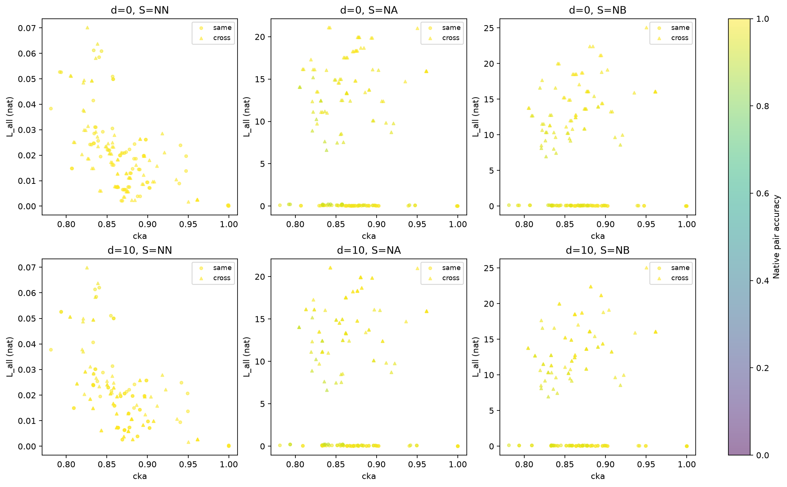
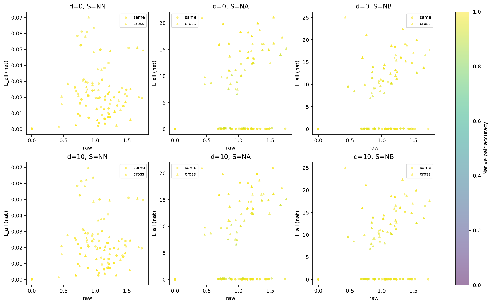
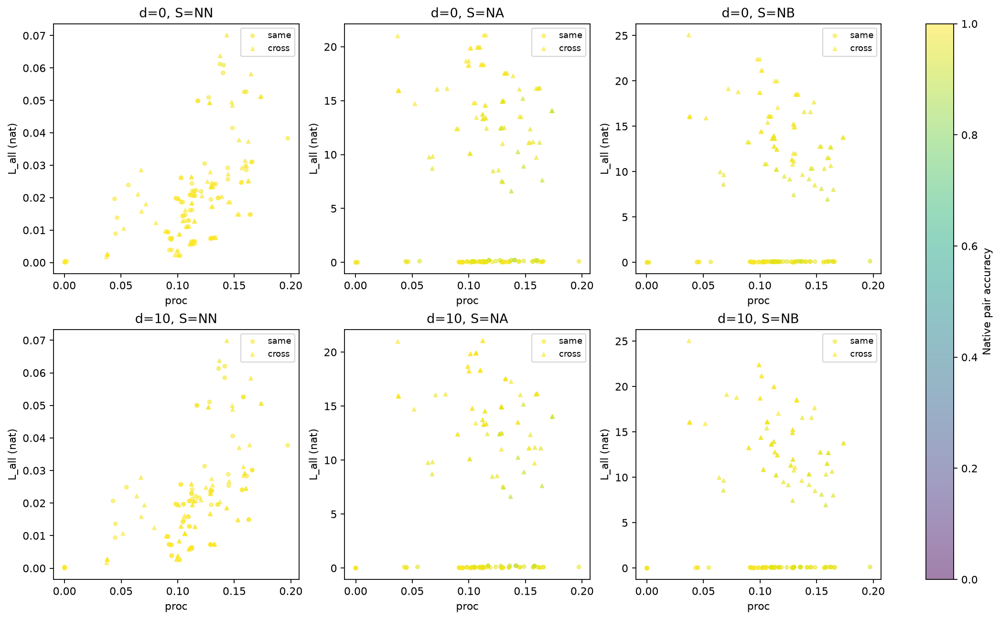
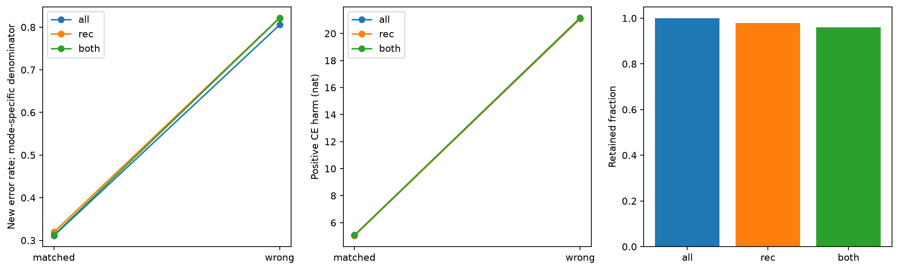

> 中文阅读版 · [冻结原件](../../../../../../../experiments/memory_interchange/results/v1_3/V_exploration/report.md) · [中文导航](../../../../../README.md)
>
> 原版本的时间、状态和结论按原记录保留；代码、字段标识、公式和原图沿用原件。

# v1.3 V 探索报告：探索性（EXPLORATORY）

V 属于模型选择数据，不能作为正式留出确认。旧 v1.2 受阻（BLOCKED） 原样保留；seed0 没有追加训练。

锁定最佳阶段步数 49500，课程累计 78000，原 V 98.6084%。旧细层门槛通过：否；新版粗门槛及此前连续点通过：是。

checkpoint SHA：`da26c47754975bac62579b477eec95fcec5599fdbaa786687463a5ca6560df02`；权重 SHA：`2925f0fb0ac74e0bae509a2b804450781b76b1f5d079f04ee863169a2c1375cf`；Adam SHA：`9d6df2f741667cb7f1dd96fea1212bee0ec2c0ae4efd9907a149892324368a6c`。

几何 V：旧前52轨道/392 内容；行为 V：旧后半6轨道/34 内容。与旧清单逐项比较，未根据输出重新选内容。

| 处理 | 全查询平均准确率 | 全查询交叉熵（nat） |
|---|---:|---:|
| 原始 | 97.9420% | 0.0582248 |
| 假替换对照 | 97.9420% | 0.0582248 |
| 匹配 | 67.9051% | 5.08034 |
| 错内容 | 17.6837% | 21.1415 |

| 样本掩码 | 保留比例 | 匹配准确率 | 错内容准确率 | 匹配 L nat | 错内容 L nat | 匹配 R | 错内容 R | 修复原始错误 | 错内容反事实符合 |
|---|---:|---:|---:|---:|---:|---:|---:|---:|---:|
| 全体 | 100.0000% | 67.9051% | 17.6837% | 5.05122 | 21.0912 | 31.0851% | 80.5391% | 1.0482% | 67.9051% |
| 接收方原生正确子集 | 97.9420% | 68.0452% | 17.7693% | 5.03458 | 21.1016 | 31.9548% | 82.2307% | 0.0000% | 67.9201% |
| 双方原生正确子集 | 95.9974% | 68.7218% | 17.8648% | 5.08487 | 21.1715 | 31.2782% | 82.1352% | 0.0000% | 67.9671% |
| 三方原生正确子集 | 94.1326% | 68.7225% | 17.9810% | 5.11153 | 21.2895 | 31.2775% | 82.0190% | 0.0000% | 68.6846% |

原始条件×S×d×查询类型的最差准确率为 84.8739%。每层计数/CE/全部真实操作与原始答对质量档保存 native_strata.csv，不用整体平均遮盖差层。

接收方原生正确子集的分母为接收方原始答对的查询；双方原生正确子集额外要求匹配供体在自身上下文、相同 S/查询下答对；三方原生正确子集再要求错误供体自身答对。供体答案无需与接收方相同。匹配与错误内容处理共用先冻结的同一样本掩码。修复率以该分析口径的查询为分母，因此接收方原生正确子集/双方原生正确子集上恒为零。所有样本仍展示；共享状态与轨道的查询不是独立统计单位。

GPU 续跑/假替换对照/全状态登记对照通过。CPU float32 严格 logit 容差通过：否，最大差 1.33514e-05、回答改变 0。相同系数转 float64，在原 2e-7/2e-6 容差下最大差 3.55271e-14；实际干预仍是 GPU float32，阈值未放宽。

| 探针目标 | 逐项目准确率（条件/间隔等权） | 完整映射准确率 |
|---|---:|---:|
| 当前 q | 80.5788% | 32.1854% |
| 初始 p_a | 99.6882% | 98.0230% |

两个探针在完全相同的 T 自然状态上拟合，相同中心化、alpha=1。初始内容更容易线性解码只表明可读性差异，不确定网络使用何种信息。

初始输入反事实为 F_b(G_b(p_a))；当前内容目标为 F_b(q)。原始 NPZ 同时保存完整映射、逐查询答案与重合关系；directions.csv 给出全体及可区分子集，mapping_diagnostics.csv 给出双向完整映射符合率。符合初始反事实与初始/历史依赖编码一致，但不能证明计算全部推迟到最后，也不能排除历史相关坐标。

| 上下文关系 | 样本掩码 | 可区分查询数 | 当前目标符合 | 初始反事实符合 | 错内容反事实（答案可区分） |
|---|---|---:|---:|---:|---:|
| 同 | 全体 | 264960 | 97.5891% | 0.8764% | 97.8741% |
| 同 | 接收方原生正确子集 | 258520 | 97.6760% | 0.8576% | 97.8841% |
| 同 | 双方原生正确子集 | 252512 | 100.0000% | 0.0000% | 97.9625% |
| 同 | 三方原生正确子集 | 247234 | 100.0000% | 0.0000% | 100.0000% |
| 跨 | 全体 | 264960 | 36.2530% | 29.1478% | 40.7029% |
| 跨 | 接收方原生正确子集 | 258520 | 36.7894% | 29.1099% | 41.1397% |
| 跨 | 双方原生正确子集 | 252407 | 36.6915% | 29.3669% | 41.5634% |
| 跨 | 三方原生正确子集 | 247113 | 37.0923% | 29.2728% | 41.5308% |

| 供体r→接收方r | 全体 L nat | 全体新增错误 | 有符号 CE 变化 nat |
|---|---:|---:|---:|
| 0→0 | 0.0445843 | 1.5202% | -1.05549e-07 |
| 0→1 | 10.3132 | 56.8744% | 10.3027 |
| 1→0 | 8.67695 | 57.2021% | 8.66973 |
| 1→1 | 0.0591835 | 2.2555% | 1.10791e-08 |

所有表均是预定配对/方向的描述性汇总；完整 d/S/H/查询类型分层及数量保存，不将共享状态查询视为独立样本。

这些结果用于描述干预和检查定义，不给单模型大样本 p 值、不声称跨种子泛化；不会据 V 效果选择指标、模型或决定正式运行。正式主标签仍为 L_all，主基线控制 D_input，敏感性分析保留接收方原生正确子集/双方原生正确子集。

