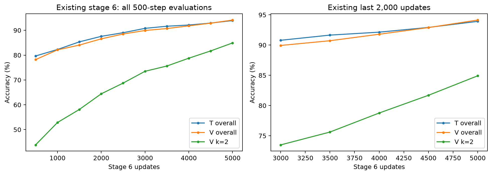
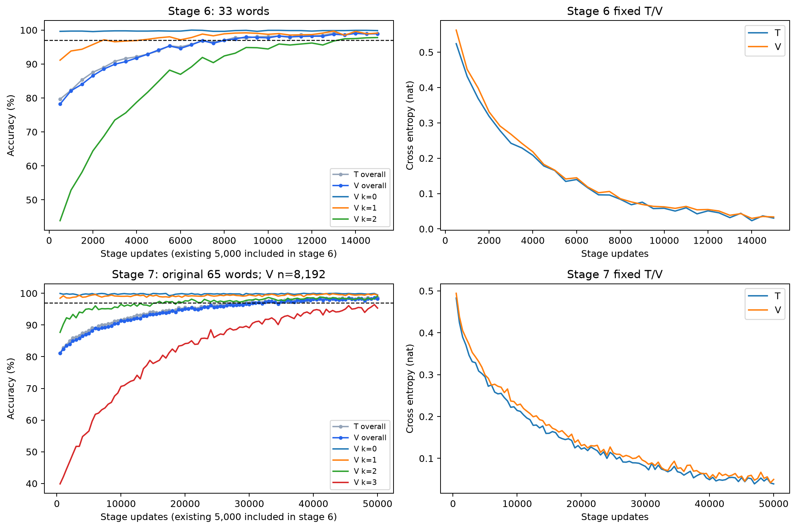

> 中文阅读版 · [冻结原件](../../../../../experiments/memory_interchange/v1_2/report.md) · [中文导航](../../../README.md)
>
> 原版本的时间、状态和结论按原记录保留；代码、字段标识、公式和原图沿用原件。

# v1.2 执行报告：受阻（BLOCKED）

日期：2026-10-12（America/Los_Angeles）。

本轮状态 **受阻（BLOCKED）**；原因 `pilot_stage_budget_exhausted`。原研究问题、主干预和科学指标沿用 v1.0。

## 恢复、保留与曲线审查

v1.0/v1.1 共 292 个源码、配置、检查点、审计与报告文件散列校验未变；原 split 与 134 个正式 B 内容保持不变。候选 B 没有续训。

A 的优先依据是旧 V 两步 84.9195%、最差真实操作层 78.0255%，相较 B 的 83.3821%/56.25% 更均衡且沿用默认初始化；未依据几何、交换或正式种子结果选择。单个先导模型差异不能证明初始化普遍优劣。

恢复源：`/home/yangx/2026COSYNE/experiments/memory_interchange/runs/v1_1/candidate_A_seed0/stage_6/latest.pt`。SHA-256：`733e4cdf820a11554d004400c0f8de76c48747b3bf59d4a00bd7f480c9c885c7`。

source 最新的阶段步数 5,000，课程累计 18,500，所有 Adam 参数步数=18,500；权重和 Python/NumPy/Generator/Torch/CUDA RNG 精确匹配。固定 T/V 准确率及各层计数一致；CE 在预登记 1e-6 nat 容差内一致。

T/V 复算绝对误差：{'T': {'准确率': 0.0, 'cross_entropy': 0.0}, 'V': {'准确率': 0.0, 'cross_entropy': 0.0}}。数值舍入与恢复错误分别检查，未用阶段 5 检查点替代。旧阶段 6 报告使用 endpoint/最新；最佳也位于 5,000。

已有阶段 6 全部十个 500 步记录，以及最近 2,000 更新的 T/V、CE、k、真实操作、上下文、d、查询类型均保存。最近 2,000 更新 V 总准确率 +4.1992 百分点，两步 +11.4202 百分点，CE −0.101599 nat；采样评价点持续改善。此趋势不单独确定失败机制。

## 课程与 checkpoint 门槛

每 500 更新固定 V 评价，总准确率 ≥97%、各原因素层 ≥95%，连续两次才晋级。阶段 6 上限包含已有 5,000，最多新增 45,000；阶段 7 上限 50,000，使用原 65 词和固定 8,192 试次 V。正式早期各阶段 20,000；单模型最多 200,000。没有新增初始化、容量、学习率、重复刺激、辅助损失或错误定向采样。

| 阶段 | 任务 | 阶段实际更新 | 课程累计 | V 准确率 | V 交叉熵（nat） | 最差真实操作层 | 两次晋级通过 |
|---:|---|---:|---:|---:|---:|---:|---|
| 1 | k≤0 / 短时序 | 4500 | 4500 | 99.2920% | 0.0440458 | 99.2920% | 是 |
| 2 | k≤0 / 中等时序 | 1000 | 5500 | 99.9756% | 0.00990222 | 99.9756% | 是 |
| 3 | k≤0 / 原始 | 1000 | 6500 | 100.0000% | 0.00381966 | 100.0000% | 是 |
| 4 | k≤1 / 原始 | 4000 | 10500 | 99.4385% | 0.032757 | 98.9258% | 是 |
| 5 | k≤1 / 原始 | 3000 | 13500 | 99.0967% | 0.0370515 | 97.9146% | 是 |
| 6 | k≤2 / 原始 | 15000 | 28500 | 98.9258% | 0.0338632 | 96.4968% | 是 |
| 7 | k≤3 / 原始 | 50000 | 78500 | 98.3154% | 0.0497601 | 91.6058% | 否 |

先导模型总更新 78500；本轮新增 60000。阶段 1–5 从旧版本保留，没有回头重训。每阶段最新/最佳/晋级的真实步数、散列、Adam/RNG 在 checkpoint_inventory.json；未晋级的阶段没有伪造晋级。

阶段 6 的 33 词结果不等于完整任务；主实验 H+S 可含三次非 N 更新，必须通过阶段 7。最新、最佳、晋级分别保留，不把较高总准确率但因素层不足的最佳当成晋级检查点。

### 阶段 7 终止点完整操作分层

| 真实操作 | T 数量 | T 准确率 | T 交叉熵（nat） | V 数量 | V 准确率 | V 交叉熵（nat） |
|---|---:|---:|---:|---:|---:|---:|
| C | 1034 | 99.6132% | 0.0108708 | 982 | 99.0835% | 0.0205363 |
| CC | 525 | 99.8095% | 0.00997053 | 521 | 99.6161% | 0.0150648 |
| CCC | 242 | 96.2810% | 0.0954364 | 274 | 91.6058% | 0.213869 |
| CCI | 270 | 98.5185% | 0.0497546 | 264 | 94.3182% | 0.155947 |
| CI | 519 | 98.2659% | 0.0403657 | 523 | 97.7055% | 0.0523889 |
| CIC | 266 | 91.3534% | 0.232824 | 247 | 92.3077% | 0.246032 |
| CII | 259 | 96.5251% | 0.10244 | 263 | 97.3384% | 0.103279 |
| I | 1014 | 99.9014% | 0.00501856 | 1023 | 99.7067% | 0.00665771 |
| IC | 504 | 98.8095% | 0.0408175 | 509 | 99.4106% | 0.025052 |
| ICC | 253 | 98.0237% | 0.0694801 | 256 | 98.4375% | 0.0832327 |
| ICI | 246 | 90.2439% | 0.248563 | 266 | 93.9850% | 0.185912 |
| II | 500 | 99.6000% | 0.00678919 | 491 | 99.7963% | 0.019684 |
| IIC | 242 | 96.6942% | 0.100158 | 260 | 96.1538% | 0.0984419 |
| III | 270 | 97.7778% | 0.0582304 | 274 | 98.5401% | 0.0432373 |
| 保持不变 | 2048 | 99.8047% | 0.00488328 | 2039 | 99.5096% | 0.013285 |

| k | T 数量 | T 准确率 | V 数量 | V 准确率 |
|---:|---:|---:|---:|---:|
| 0 | 2048 | 99.8047% | 2039 | 99.5096% |
| 1 | 2048 | 99.7559% | 2005 | 99.4015% |
| 2 | 2048 | 99.1211% | 2044 | 99.1194% |
| 3 | 2048 | 95.7031% | 2104 | 95.3422% |

阶段 7 最佳：49500 步、V 98.6084%；本表使用最新终止点，未把最佳与最新混写。

### 恢复点步数 5,000：固定 T/V 两步诊断

| 集合 | 两步数 | 单查询正确率 | 正向完整映射正确 | 反向完整映射正确 | 双向同时正确 | 正向双射 | 反向双射 | 查询互逆 |
|---|---:|---:|---:|---:|---:|---:|---:|---:|
| T | 1365 | 83.7363% | 35.5311% | 40.2930% | 20.0000% | 36.8498% | 41.2454% | 20.0000% |
| V | 1366 | 84.9195% | 31.9912% | 38.2138% | 16.4714% | 33.3089% | 39.7511% | 16.4714% |

候选答案分别为正序两步、仅第一步、仅第二步、不更新、反序。保存每个原试次全部候选答案/映射及两两重合关系。下表仅统计候选答案与正确答案不同的查询；空集不作判断。

| 集合 | 真实顺序 | 候选 | 可区分查询数 | 预测符合率 |
|---|---|---|---:|---:|
| T | II | 只执行第一步 | 238 | 8.8235% |
| T | II | 只执行第二步 | 238 | 8.8235% |
| T | II | 完全不更新 | 0 | 不可区分 |
| T | II | 反序执行 | 0 | 不可区分 |
| T | CC | 只执行第一步 | 293 | 10.9215% |
| T | CC | 只执行第二步 | 293 | 10.9215% |
| T | CC | 完全不更新 | 0 | 不可区分 |
| T | CC | 反序执行 | 0 | 不可区分 |
| T | IC | 只执行第一步 | 287 | 9.7561% |
| T | IC | 只执行第二步 | 233 | 8.5837% |
| T | IC | 完全不更新 | 293 | 12.9693% |
| T | IC | 反序执行 | 293 | 8.1911% |
| T | CI | 只执行第一步 | 239 | 15.0628% |
| T | CI | 只执行第二步 | 291 | 3.7801% |
| T | CI | 完全不更新 | 295 | 7.7966% |
| T | CI | 反序执行 | 289 | 5.8824% |
| V | II | 只执行第一步 | 253 | 7.1146% |
| V | II | 只执行第二步 | 253 | 7.1146% |
| V | II | 完全不更新 | 0 | 不可区分 |
| V | II | 反序执行 | 0 | 不可区分 |
| V | CC | 只执行第一步 | 291 | 9.6220% |
| V | CC | 只执行第二步 | 291 | 9.6220% |
| V | CC | 完全不更新 | 0 | 不可区分 |
| V | CC | 反序执行 | 0 | 不可区分 |
| V | IC | 只执行第一步 | 305 | 6.2295% |
| V | IC | 只执行第二步 | 270 | 6.2963% |
| V | IC | 完全不更新 | 325 | 8.6154% |
| V | IC | 反序执行 | 314 | 5.7325% |
| V | CI | 只执行第一步 | 229 | 20.0873% |
| V | CI | 只执行第二步 | 274 | 4.3796% |
| V | CI | 完全不更新 | 270 | 6.2963% |
| V | CI | 反序执行 | 269 | 7.4349% |

所有查询的符合率、在全部候选中唯一的子集符合率、候选完整映射符合率分别保存在诊断 summary.json 和 NPZ；不能把候选重合产生的符合称为跳步或反序证据。II/CC 的反序与正确执行相同。IC/CI 也只在预先定义的可区分子集描述行为。完整查询映射利用已有读出，未向隐藏状态写入真值或新增训练损失。

真实操作与可见词同时保存：IC 在 r=0 为 AB、r=1 为 BA；CI 相反。分层 CSV 保存真实操作、上下文、可见顺序、六种槽位对、d、查询类型及描述性交叉格的计数、准确率与 CE。任何分层模式只能提出进一步检验方向，不能确定内部计算机制。

T 未达到原 95% 因素门槛的真实操作层：CC, CI, IC, II。这些层分别保存刺激结束、交换时点、最终查询的敏感性、实际计算图梯度和门值分布；选取各层固定顺序的至多 64 个试次，不设置 L2/门值阈值。
V 未达到原 95% 因素门槛的真实操作层：CC, CI, IC, II。这些层分别保存刺激结束、交换时点、最终查询的敏感性、实际计算图梯度和门值分布；选取各层固定顺序的至多 64 个试次，不设置 L2/门值阈值。

| V 真实顺序 | r | 可见顺序 | n | 准确率 | 交叉熵（nat） |
|---|---:|---|---:|---:|---:|
| II | 0 | AA | 175 | 94.8571% | 0.202081 |
| II | 1 | BB | 168 | 91.6667% | 0.292572 |
| CC | 0 | BB | 174 | 86.7816% | 0.361061 |
| CC | 1 | AA | 167 | 83.8323% | 0.455777 |
| IC | 0 | AB | 175 | 82.8571% | 0.432541 |
| IC | 1 | BA | 193 | 82.3834% | 0.52152 |
| CI | 0 | BA | 149 | 87.9195% | 0.276132 |
| CI | 1 | AB | 165 | 69.0909% | 0.750604 |

非零内容敏感性说明刺激影响输出，不能证明保存了正确更新后的完整内容。正确行为也可能由控制状态保存历史、最终读出时计算得到；原状态交换分析仍然必要。

### 阶段 6 晋级/终止点：固定 T/V 两步诊断

| 集合 | 两步数 | 单查询正确率 | 正向完整映射正确 | 反向完整映射正确 | 双向同时正确 | 正向双射 | 反向双射 | 查询互逆 |
|---|---:|---:|---:|---:|---:|---:|---:|---:|
| T | 1365 | 97.8755% | 86.6667% | 88.4982% | 77.8755% | 86.7399% | 88.4982% | 77.8755% |
| V | 1366 | 97.8038% | 82.5037% | 87.6281% | 73.0600% | 82.5037% | 87.7745% | 73.0600% |

候选答案分别为正序两步、仅第一步、仅第二步、不更新、反序。保存每个原试次全部候选答案/映射及两两重合关系。下表仅统计候选答案与正确答案不同的查询；空集不作判断。

| 集合 | 真实顺序 | 候选 | 可区分查询数 | 预测符合率 |
|---|---|---|---:|---:|
| T | II | 只执行第一步 | 238 | 0.8403% |
| T | II | 只执行第二步 | 238 | 0.8403% |
| T | II | 完全不更新 | 0 | 不可区分 |
| T | II | 反序执行 | 0 | 不可区分 |
| T | CC | 只执行第一步 | 293 | 0.3413% |
| T | CC | 只执行第二步 | 293 | 0.3413% |
| T | CC | 完全不更新 | 0 | 不可区分 |
| T | CC | 反序执行 | 0 | 不可区分 |
| T | IC | 只执行第一步 | 287 | 1.0453% |
| T | IC | 只执行第二步 | 233 | 0.0000% |
| T | IC | 完全不更新 | 293 | 1.3652% |
| T | IC | 反序执行 | 293 | 0.6826% |
| T | CI | 只执行第一步 | 239 | 3.7657% |
| T | CI | 只执行第二步 | 291 | 0.3436% |
| T | CI | 完全不更新 | 295 | 0.3390% |
| T | CI | 反序执行 | 289 | 0.6920% |
| V | II | 只执行第一步 | 253 | 1.1858% |
| V | II | 只执行第二步 | 253 | 1.1858% |
| V | II | 完全不更新 | 0 | 不可区分 |
| V | II | 反序执行 | 0 | 不可区分 |
| V | CC | 只执行第一步 | 291 | 0.3436% |
| V | CC | 只执行第二步 | 291 | 0.3436% |
| V | CC | 完全不更新 | 0 | 不可区分 |
| V | CC | 反序执行 | 0 | 不可区分 |
| V | IC | 只执行第一步 | 305 | 1.3115% |
| V | IC | 只执行第二步 | 270 | 1.1111% |
| V | IC | 完全不更新 | 325 | 0.9231% |
| V | IC | 反序执行 | 314 | 0.6369% |
| V | CI | 只执行第一步 | 229 | 1.7467% |
| V | CI | 只执行第二步 | 274 | 0.7299% |
| V | CI | 完全不更新 | 270 | 0.7407% |
| V | CI | 反序执行 | 269 | 1.1152% |

所有查询的符合率、在全部候选中唯一的子集符合率、候选完整映射符合率分别保存在诊断 summary.json 和 NPZ；不能把候选重合产生的符合称为跳步或反序证据。II/CC 的反序与正确执行相同。IC/CI 也只在预先定义的可区分子集描述行为。完整查询映射利用已有读出，未向隐藏状态写入真值或新增训练损失。

真实操作与可见词同时保存：IC 在 r=0 为 AB、r=1 为 BA；CI 相反。分层 CSV 保存真实操作、上下文、可见顺序、六种槽位对、d、查询类型及描述性交叉格的计数、准确率与 CE。任何分层模式只能提出进一步检验方向，不能确定内部计算机制。

T 未达到原 95% 因素门槛的真实操作层：无。这些层分别保存刺激结束、交换时点、最终查询的敏感性、实际计算图梯度和门值分布；选取各层固定顺序的至多 64 个试次，不设置 L2/门值阈值。
V 未达到原 95% 因素门槛的真实操作层：无。这些层分别保存刺激结束、交换时点、最终查询的敏感性、实际计算图梯度和门值分布；选取各层固定顺序的至多 64 个试次，不设置 L2/门值阈值。

| V 真实顺序 | r | 可见顺序 | n | 准确率 | 交叉熵（nat） |
|---|---:|---|---:|---:|---:|
| II | 0 | AA | 175 | 98.2857% | 0.0525578 |
| II | 1 | BB | 168 | 100.0000% | 0.0263348 |
| CC | 0 | BB | 174 | 98.8506% | 0.0372273 |
| CC | 1 | AA | 167 | 98.8024% | 0.0658897 |
| IC | 0 | AB | 175 | 95.4286% | 0.130842 |
| IC | 1 | BA | 193 | 97.9275% | 0.100858 |
| CI | 0 | BA | 149 | 96.6443% | 0.0617584 |
| CI | 1 | AB | 165 | 96.3636% | 0.111605 |

非零内容敏感性说明刺激影响输出，不能证明保存了正确更新后的完整内容。正确行为也可能由控制状态保存历史、最终读出时计算得到；原状态交换分析仍然必要。

### 阶段 7 晋级/终止点：固定 T/V 两步诊断

| 集合 | 两步数 | 单查询正确率 | 正向完整映射正确 | 反向完整映射正确 | 双向同时正确 | 正向双射 | 反向双射 | 查询互逆 |
|---|---:|---:|---:|---:|---:|---:|---:|---:|
| T | 2048 | 99.1211% | 93.7012% | 89.6484% | 84.5215% | 93.7012% | 89.6484% | 84.5215% |
| V | 2044 | 99.1194% | 92.3679% | 90.3131% | 84.3444% | 92.3679% | 90.3131% | 84.3444% |

候选答案分别为正序两步、仅第一步、仅第二步、不更新、反序。保存每个原试次全部候选答案/映射及两两重合关系。下表仅统计候选答案与正确答案不同的查询；空集不作判断。

| 集合 | 真实顺序 | 候选 | 可区分查询数 | 预测符合率 |
|---|---|---|---:|---:|
| T | II | 只执行第一步 | 377 | 0.2653% |
| T | II | 只执行第二步 | 377 | 0.2653% |
| T | II | 完全不更新 | 0 | 不可区分 |
| T | II | 反序执行 | 0 | 不可区分 |
| T | CC | 只执行第一步 | 457 | 0.2188% |
| T | CC | 只执行第二步 | 457 | 0.2188% |
| T | CC | 完全不更新 | 0 | 不可区分 |
| T | CC | 反序执行 | 0 | 不可区分 |
| T | IC | 只执行第一步 | 423 | 0.2364% |
| T | IC | 只执行第二步 | 367 | 0.2725% |
| T | IC | 完全不更新 | 437 | 0.2288% |
| T | IC | 反序执行 | 430 | 0.2326% |
| T | CI | 只执行第一步 | 385 | 1.5584% |
| T | CI | 只执行第二步 | 442 | 0.0000% |
| T | CI | 完全不更新 | 448 | 0.4464% |
| T | CI | 反序执行 | 449 | 1.3363% |
| V | II | 只执行第一步 | 348 | 0.0000% |
| V | II | 只执行第二步 | 348 | 0.0000% |
| V | II | 完全不更新 | 0 | 不可区分 |
| V | II | 反序执行 | 0 | 不可区分 |
| V | CC | 只执行第一步 | 440 | 0.0000% |
| V | CC | 只执行第二步 | 440 | 0.0000% |
| V | CC | 完全不更新 | 0 | 不可区分 |
| V | CC | 反序执行 | 0 | 不可区分 |
| V | IC | 只执行第一步 | 438 | 0.0000% |
| V | IC | 只执行第二步 | 374 | 0.0000% |
| V | IC | 完全不更新 | 431 | 0.0000% |
| V | IC | 反序执行 | 436 | 0.2294% |
| V | CI | 只执行第一步 | 397 | 1.2594% |
| V | CI | 只执行第二步 | 449 | 0.2227% |
| V | CI | 完全不更新 | 449 | 0.8909% |
| V | CI | 反序执行 | 450 | 1.1111% |

所有查询的符合率、在全部候选中唯一的子集符合率、候选完整映射符合率分别保存在诊断 summary.json 和 NPZ；不能把候选重合产生的符合称为跳步或反序证据。II/CC 的反序与正确执行相同。IC/CI 也只在预先定义的可区分子集描述行为。完整查询映射利用已有读出，未向隐藏状态写入真值或新增训练损失。

真实操作与可见词同时保存：IC 在 r=0 为 AB、r=1 为 BA；CI 相反。分层 CSV 保存真实操作、上下文、可见顺序、六种槽位对、d、查询类型及描述性交叉格的计数、准确率与 CE。任何分层模式只能提出进一步检验方向，不能确定内部计算机制。

T 未达到原 95% 因素门槛的真实操作层：CIC, ICI。这些层分别保存刺激结束、交换时点、最终查询的敏感性、实际计算图梯度和门值分布；选取各层固定顺序的至多 64 个试次，不设置 L2/门值阈值。
V 未达到原 95% 因素门槛的真实操作层：CCC, CCI, CIC, ICI。这些层分别保存刺激结束、交换时点、最终查询的敏感性、实际计算图梯度和门值分布；选取各层固定顺序的至多 64 个试次，不设置 L2/门值阈值。

| V 真实顺序 | r | 可见顺序 | n | 准确率 | 交叉熵（nat） |
|---|---:|---|---:|---:|---:|
| II | 0 | AA | 220 | 100.0000% | 0.00662785 |
| II | 1 | BB | 271 | 99.6310% | 0.030283 |
| CC | 0 | BB | 244 | 99.5902% | 0.013588 |
| CC | 1 | AA | 277 | 99.6390% | 0.0163657 |
| IC | 0 | AB | 251 | 98.8048% | 0.0376635 |
| IC | 1 | BA | 258 | 100.0000% | 0.0127827 |
| CI | 0 | BA | 256 | 98.4375% | 0.0429707 |
| CI | 1 | AB | 267 | 97.0037% | 0.061419 |

非零内容敏感性说明刺激影响输出，不能证明保存了正确更新后的完整内容。正确行为也可能由控制状态保存历史、最终读出时计算得到；原状态交换分析仍然必要。

### 两步诊断的描述性定位

恢复点 V 的真实 IC 在 r=0/1 分别为 82.86%/82.38%；真实 CI 为 87.92%/69.09%。可见 AB 在两个上下文对应不同真实操作，分别为 82.86%/69.09%。这些结果同时存在操作与上下文/线索的不均衡，不能仅归因于某个数学操作。

恢复点 d=0/10 两步 V 为 85.97%/83.91%；槽位 (1,2) 为 88.16%，(2,4) 为 82.46%。槽位与 d 的交叉格并非一致地随 d 恶化，因此不能凭这些表认定单一保持衰减机制。计数和全部交叉格均保存。

恢复点 CI 的“只执行第一步”在答案可区分的 V 查询上符合率为 20.09%（46/229），但在候选完整映射可区分的子集上，没有一个双向完整预测映射整体等于该候选。此处有查询层面的行为模式，尚不足以证明内部跳过第二步。

同一阶段 6 固定 V 的两步双向完整映射正确率从 16.47% 升至晋级点 73.06%，两步学习随预算延长明显改善，仍不能据此证明逐步更新。原任务终止点主要门槛缺口为三步操作因素，而非 k=0/1 遗忘。

recovery_diagnostics/ 另保存三个诊断时点固定首 64 行的完整 T/V 敏感性、梯度、门分布；权重、Adam 全部状态/参数组与全部 RNG 均再次精确核验。没有优化或改写检查点。

## 本轮未启动科学分析

先导模型失败阶段：7。若达到阶段上限，仅说明本预算内未达到门槛，不能声称默认模型无法学习该函数。G/B 未计算，正式 101–106 未运行；H1/H2/H3 均未检验。完整 500 步学习曲线、全部操作因素、最新/最佳的权重、Adam、RNG 和诊断原始数据已保留。

## 成本、可复现与解释边界

恢复前吞吐实测 141.41 更新/秒（200 步临时权重/Adam/RNG 全部丢弃并恢复）。训练、验证、保存、缓存及 GPU 分析的累计保守记账 1080.079 秒（0.3000 小时），其中此前 605.515 秒；总上限 12 小时。科学 CPU 自助重采样单列墙钟，不充作 GPU 时间。

执行命令：`python -m experiments.memory_interchange.v1_2.run`。程序按已完成 summary/检查点恢复；校验旧版本与冻结源，停止点由登记预算和门槛决定。测试结果在 results/v1_2/tests.txt；恢复单独复算和实际源散列在 restore_consistency.json。

配置：revision_v1_2.yaml；改动：CHANGES.md。datasets 沿用 results/v1_1/datasets，不生成新的 V；原 8,192 V 与 split 文件散列冻结。学习曲线包含阶段 6 的旧 5,000；每点评价因素的 n、准确率、CE 全部保存。

候选 m/c 来自预先指定结构，不证明天然的独立记忆脑区。即使正确行为达到门槛，也不能证明逐步可复用的内部更新；状态交换及后续行为仍须检验。数学性质不等于网络学会群结构，本实验不能外推真实神经系统。未检索更新相关工作或判断原创性，论文提交前仍需核对。

**最终状态：受阻（BLOCKED）。**
