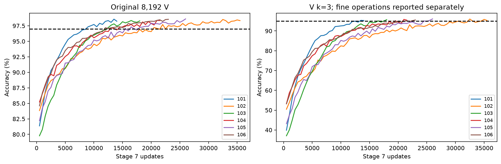
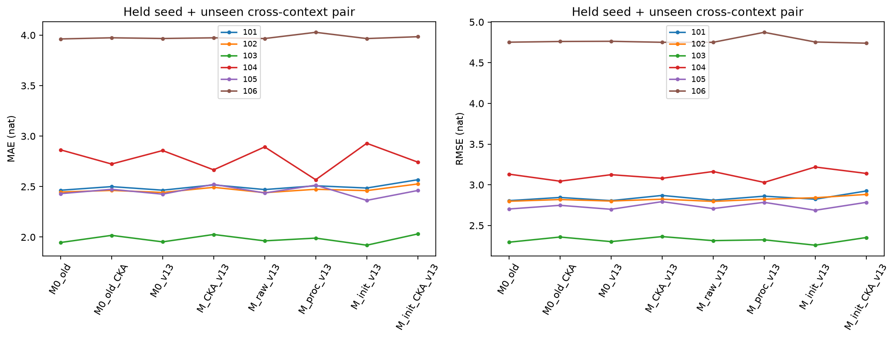
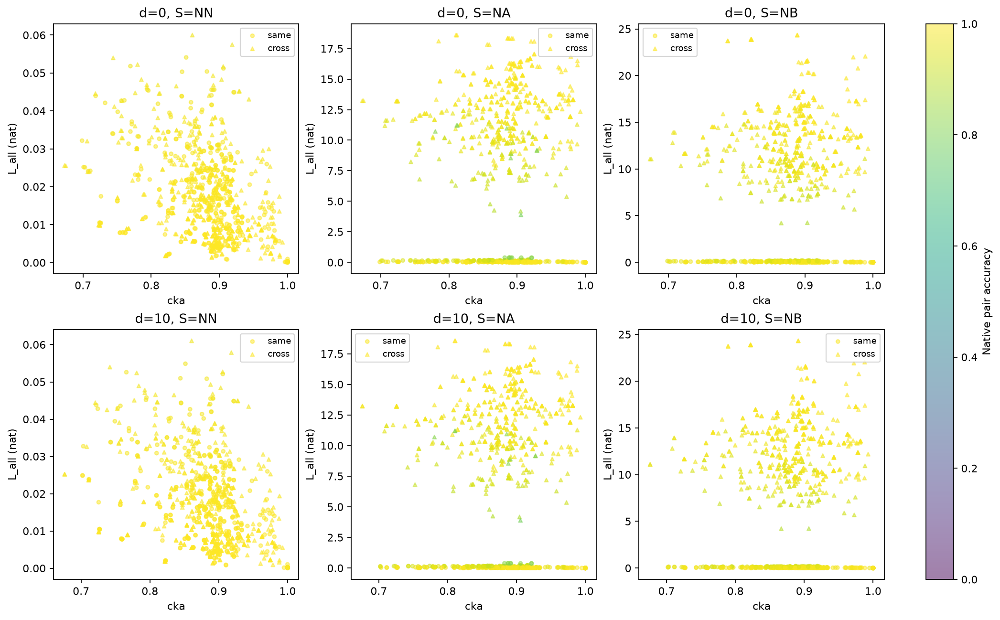
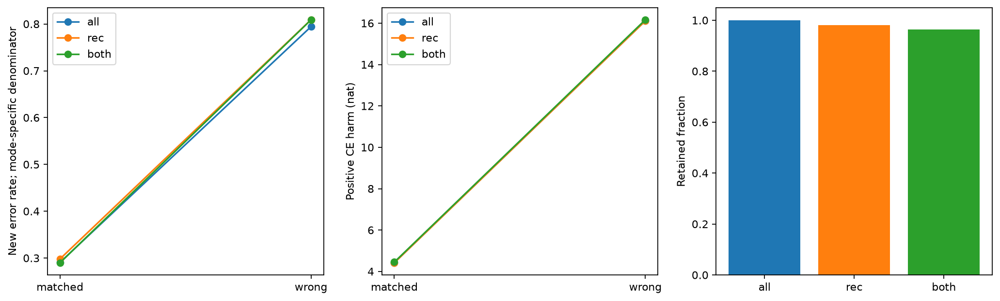
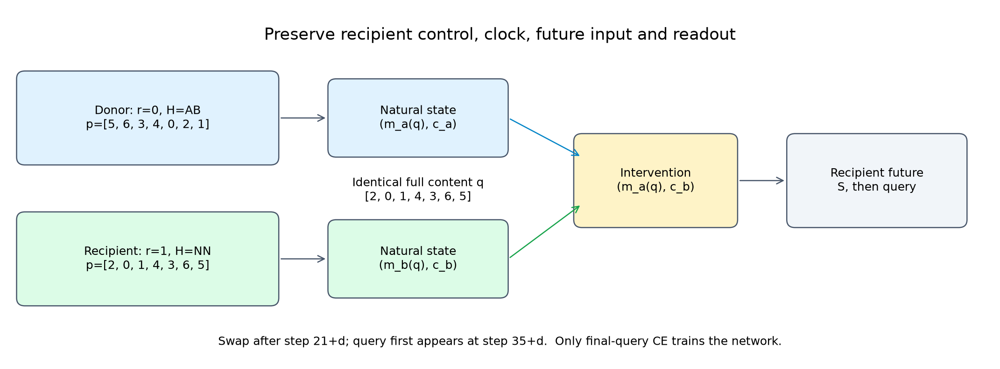

> 中文阅读版 · [冻结原件](../../../../../experiments/memory_interchange/v1_3/report.md) · [中文导航](../../../README.md)
>
> 原版本的时间、状态和结论按原记录保留；代码、字段标识、公式和原图沿用原件。

# v1.3 执行报告：已完成（COMPLETED）

日期：2026-10-12（America/Los_Angeles）。

v1.2 的受阻（BLOCKED） 未回写。v1.3 明确修改阶段 7 晋级规则，旧细操作层仍逐项展示，整体准确率不替代条件表现。seed0 固定最佳 49,500，不续训或更换。

V 探索单列 [V 探索报告](../results/v1_3/V_exploration/report.md)。科学指标、训练与分析规则在正式 G/B 打开之前冻结；探索结果不决定是否继续正式运行。

累计 GPU 保守记账 3313.147 秒（0.9203 小时），继承此前 1080.079 秒，上限12小时。CPU 自助重采样墙钟另列。

## 六种子原任务与细层状态

| 种子 | 课程更新 | 新课程通过 | 选定原 V | 新粗层通过 | 旧细层通过 | B 最差条件层 |
|---:|---:|---|---:|---|---|---:|
| 101 | 37000 | 是 | 98.5718% | 是 | 否 | 82.4094% |
| 102 | 61000 | 是 | 98.5229% | 是 | 否 | 90.6183% |
| 103 | 40000 | 是 | 98.3521% | 是 | 否 | 87.1002% |
| 104 | 47500 | 是 | 98.3643% | 是 | 否 | 86.4606% |
| 105 | 49500 | 是 | 98.6084% | 是 | 否 | 85.6077% |
| 106 | 48500 | 是 | 98.5474% | 是 | 否 | 60.6610% |

全部种子新初始化，不从先导模型微调，失败种子保留、没有替换或依据交换续训。每个真实操作词、k、r、d、查询层的 n/准确率/CE 保存在 selected_validation.json、每500步曲线和 native_strata.csv；全部检查点含 Adam 与 RNG。初始 CKA 使用课程开始前权重。

B 原始质量按接收方×S×d×查询类型，以及标签的双向原始平均正确率分别固定 ≥95%、90–95%、<90%；分档只用于展示，不能筛训练模型或排除不利测试行。

## 种子 101：干预与反事实

| 处理 | 全查询平均准确率 | 全查询交叉熵（nat） |
|---|---:|---:|
| 原始 | 98.2923% | 0.0502797 |
| 假替换对照 | 98.2923% | 0.0502797 |
| 匹配 | 70.2769% | 4.16661 |
| 错内容 | 19.0626% | 15.7444 |

| 样本掩码 | 保留比例 | 匹配准确率 | 错内容准确率 | 匹配 L nat | 错内容 L nat | 匹配 R | 错内容 R | 修复原始错误 | 错内容反事实符合 |
|---|---:|---:|---:|---:|---:|---:|---:|---:|---:|
| 全体 | 100.0000% | 70.2769% | 19.0626% | 4.14313 | 15.7019 | 28.9503% | 79.5017% | 0.9349% | 70.2769% |
| 接收方原生正确子集 | 98.2923% | 70.3619% | 19.1147% | 4.1275 | 15.6827 | 29.6381% | 80.8853% | 0.0000% | 70.2508% |
| 双方原生正确子集 | 96.6499% | 71.0823% | 19.1579% | 4.15638 | 15.7323 | 28.9177% | 80.8421% | 0.0000% | 70.2681% |
| 三方原生正确子集 | 95.1173% | 71.0952% | 19.1789% | 4.17383 | 15.814 | 28.9048% | 80.8211% | 0.0000% | 70.9884% |

原始条件×S×d×查询类型的最差准确率为 82.4094%。每层计数/CE/全部真实操作与原始答对质量档保存 native_strata.csv，不用整体平均遮盖差层。

接收方原生正确子集的分母为接收方原始答对的查询；双方原生正确子集额外要求匹配供体在自身上下文、相同 S/查询下答对；三方原生正确子集再要求错误供体自身答对。供体答案无需与接收方相同。匹配与错误内容处理共用先冻结的同一样本掩码。修复率以该分析口径的查询为分母，因此接收方原生正确子集/双方原生正确子集上恒为零。所有样本仍展示；共享状态与轨道的查询不是独立统计单位。

GPU 续跑/假替换对照/全状态登记对照通过。CPU float32 严格 logit 容差通过：否，最大差 1.52588e-05、回答改变 0。相同系数转 float64，在原 2e-7/2e-6 容差下最大差 2.13163e-14；实际干预仍是 GPU float32，阈值未放宽。

| 探针目标 | 逐项目准确率（条件/间隔等权） | 完整映射准确率 |
|---|---:|---:|
| 当前 q | 71.6504% | 20.2292% |
| 初始 p_a | 100.0000% | 100.0000% |

两个探针在完全相同的 T 自然状态上拟合，相同中心化、alpha=1。初始内容更容易线性解码只表明可读性差异，不确定网络使用何种信息。

初始输入反事实为 F_b(G_b(p_a))；当前内容目标为 F_b(q)。原始 NPZ 同时保存完整映射、逐查询答案与重合关系；directions.csv 给出全体及可区分子集，mapping_diagnostics.csv 给出双向完整映射符合率。符合初始反事实与初始/历史依赖编码一致，但不能证明计算全部推迟到最后，也不能排除历史相关坐标。

| 上下文关系 | 样本掩码 | 可区分查询数 | 当前目标符合 | 初始反事实符合 | 错内容反事实（答案可区分） |
|---|---|---:|---:|---:|---:|
| 同 | 全体 | 1069056 | 97.9984% | 0.7198% | 98.2493% |
| 同 | 接收方原生正确子集 | 1047694 | 98.0288% | 0.7117% | 98.2466% |
| 同 | 双方原生正确子集 | 1027042 | 100.0000% | 0.0000% | 98.3413% |
| 同 | 三方原生正确子集 | 1008881 | 100.0000% | 0.0000% | 100.0000% |
| 跨 | 全体 | 1069056 | 42.7823% | 26.1131% | 46.1510% |
| 跨 | 接收方原生正确子集 | 1047694 | 43.2518% | 26.1405% | 46.4799% |
| 跨 | 双方原生正确子集 | 1027273 | 43.4958% | 26.1302% | 46.7637% |
| 跨 | 三方原生正确子集 | 1008978 | 43.8398% | 26.1202% | 46.9827% |

| 供体r→接收方r | 全体 L nat | 全体新增错误 | 有符号 CE 变化 nat |
|---|---:|---:|---:|
| 0→0 | 0.0450499 | 1.5486% | 1.93508e-10 |
| 0→1 | 7.9891 | 53.2434% | 7.97902 |
| 1→0 | 7.58231 | 53.2627% | 7.57156 |
| 1→1 | 0.0454311 | 1.6710% | -1.67152e-09 |

所有表均是预定配对/方向的描述性汇总；完整 d/S/H/查询类型分层及数量保存，不将共享状态查询视为独立样本。

## 种子 102：干预与反事实

| 处理 | 全查询平均准确率 | 全查询交叉熵（nat） |
|---|---:|---:|
| 原始 | 98.3653% | 0.0465358 |
| 假替换对照 | 98.3653% | 0.0465358 |
| 匹配 | 70.2995% | 4.63657 |
| 错内容 | 19.0227% | 16.7772 |

| 样本掩码 | 保留比例 | 匹配准确率 | 错内容准确率 | 匹配 L nat | 错内容 L nat | 匹配 R | 错内容 R | 修复原始错误 | 错内容反事实符合 |
|---|---:|---:|---:|---:|---:|---:|---:|---:|---:|
| 全体 | 100.0000% | 70.2995% | 19.0227% | 4.61485 | 16.7384 | 28.9699% | 79.6179% | 0.9041% | 70.2995% |
| 接收方原生正确子集 | 98.3653% | 70.3882% | 19.0570% | 4.61444 | 16.7391 | 29.6118% | 80.9430% | 0.0000% | 70.2739% |
| 双方原生正确子集 | 96.8156% | 71.0375% | 19.0859% | 4.6511 | 16.7648 | 28.9625% | 80.9141% | 0.0000% | 70.2645% |
| 三方原生正确子集 | 95.3104% | 71.0054% | 19.1300% | 4.66876 | 16.8482 | 28.9946% | 80.8700% | 0.0000% | 70.9460% |

原始条件×S×d×查询类型的最差准确率为 90.6183%。每层计数/CE/全部真实操作与原始答对质量档保存 native_strata.csv，不用整体平均遮盖差层。

接收方原生正确子集的分母为接收方原始答对的查询；双方原生正确子集额外要求匹配供体在自身上下文、相同 S/查询下答对；三方原生正确子集再要求错误供体自身答对。供体答案无需与接收方相同。匹配与错误内容处理共用先冻结的同一样本掩码。修复率以该分析口径的查询为分母，因此接收方原生正确子集/双方原生正确子集上恒为零。所有样本仍展示；共享状态与轨道的查询不是独立统计单位。

GPU 续跑/假替换对照/全状态登记对照通过。CPU float32 严格 logit 容差通过：否，最大差 1.62125e-05、回答改变 0。相同系数转 float64，在原 2e-7/2e-6 容差下最大差 4.79616e-14；实际干预仍是 GPU float32，阈值未放宽。

| 探针目标 | 逐项目准确率（条件/间隔等权） | 完整映射准确率 |
|---|---:|---:|
| 当前 q | 90.8399% | 58.0906% |
| 初始 p_a | 94.1517% | 78.9295% |

两个探针在完全相同的 T 自然状态上拟合，相同中心化、alpha=1。初始内容更容易线性解码只表明可读性差异，不确定网络使用何种信息。

初始输入反事实为 F_b(G_b(p_a))；当前内容目标为 F_b(q)。原始 NPZ 同时保存完整映射、逐查询答案与重合关系；directions.csv 给出全体及可区分子集，mapping_diagnostics.csv 给出双向完整映射符合率。符合初始反事实与初始/历史依赖编码一致，但不能证明计算全部推迟到最后，也不能排除历史相关坐标。

| 上下文关系 | 样本掩码 | 可区分查询数 | 当前目标符合 | 初始反事实符合 | 错内容反事实（答案可区分） |
|---|---|---:|---:|---:|---:|
| 同 | 全体 | 1069056 | 98.1827% | 0.6979% | 98.3959% |
| 同 | 接收方原生正确子集 | 1049848 | 98.2638% | 0.6637% | 98.3968% |
| 同 | 双方原生正确子集 | 1031621 | 100.0000% | 0.0000% | 98.4380% |
| 同 | 三方原生正确子集 | 1015208 | 100.0000% | 0.0000% | 100.0000% |
| 跨 | 全体 | 1069056 | 42.7733% | 25.9362% | 46.1589% |
| 跨 | 接收方原生正确子集 | 1049848 | 43.1702% | 25.8481% | 46.4111% |
| 跨 | 双方原生正确子集 | 1031620 | 43.3479% | 25.8863% | 46.6670% |
| 跨 | 三方原生正确子集 | 1015485 | 43.6095% | 25.8025% | 46.8286% |

| 供体r→接收方r | 全体 L nat | 全体新增错误 | 有符号 CE 变化 nat |
|---|---:|---:|---:|
| 0→0 | 0.0393738 | 1.4079% | 5.609e-08 |
| 0→1 | 9.96848 | 53.3449% | 9.95644 |
| 1→0 | 7.39308 | 53.4369% | 7.38367 |
| 1→1 | 0.0419784 | 1.5848% | 1.17432e-07 |

所有表均是预定配对/方向的描述性汇总；完整 d/S/H/查询类型分层及数量保存，不将共享状态查询视为独立样本。

## 种子 103：干预与反事实

| 处理 | 全查询平均准确率 | 全查询交叉熵（nat） |
|---|---:|---:|
| 原始 | 98.1822% | 0.0531965 |
| 假替换对照 | 98.1822% | 0.0531965 |
| 匹配 | 70.1642% | 3.84737 |
| 错内容 | 19.0847% | 14.2131 |

| 样本掩码 | 保留比例 | 匹配准确率 | 错内容准确率 | 匹配 L nat | 错内容 L nat | 匹配 R | 错内容 R | 修复原始错误 | 错内容反事实符合 |
|---|---:|---:|---:|---:|---:|---:|---:|---:|---:|
| 全体 | 100.0000% | 70.1642% | 19.0847% | 3.8225 | 14.1681 | 29.0270% | 79.3925% | 1.0090% | 70.1642% |
| 接收方原生正确子集 | 98.1822% | 70.2450% | 19.1362% | 3.81202 | 14.1599 | 29.7550% | 80.8638% | 0.0000% | 70.1646% |
| 双方原生正确子集 | 96.4501% | 71.0355% | 19.1640% | 3.8405 | 14.2031 | 28.9645% | 80.8360% | 0.0000% | 70.1973% |
| 三方原生正确子集 | 94.8081% | 71.0183% | 19.1614% | 3.86063 | 14.2876 | 28.9817% | 80.8386% | 0.0000% | 71.0090% |

原始条件×S×d×查询类型的最差准确率为 87.1002%。每层计数/CE/全部真实操作与原始答对质量档保存 native_strata.csv，不用整体平均遮盖差层。

接收方原生正确子集的分母为接收方原始答对的查询；双方原生正确子集额外要求匹配供体在自身上下文、相同 S/查询下答对；三方原生正确子集再要求错误供体自身答对。供体答案无需与接收方相同。匹配与错误内容处理共用先冻结的同一样本掩码。修复率以该分析口径的查询为分母，因此接收方原生正确子集/双方原生正确子集上恒为零。所有样本仍展示；共享状态与轨道的查询不是独立统计单位。

GPU 续跑/假替换对照/全状态登记对照通过。CPU float32 严格 logit 容差通过：否，最大差 1.38283e-05、回答改变 0。相同系数转 float64，在原 2e-7/2e-6 容差下最大差 2.84217e-14；实际干预仍是 GPU float32，阈值未放宽。

| 探针目标 | 逐项目准确率（条件/间隔等权） | 完整映射准确率 |
|---|---:|---:|
| 当前 q | 71.3536% | 18.0838% |
| 初始 p_a | 100.0000% | 100.0000% |

两个探针在完全相同的 T 自然状态上拟合，相同中心化、alpha=1。初始内容更容易线性解码只表明可读性差异，不确定网络使用何种信息。

初始输入反事实为 F_b(G_b(p_a))；当前内容目标为 F_b(q)。原始 NPZ 同时保存完整映射、逐查询答案与重合关系；directions.csv 给出全体及可区分子集，mapping_diagnostics.csv 给出双向完整映射符合率。符合初始反事实与初始/历史依赖编码一致，但不能证明计算全部推迟到最后，也不能排除历史相关坐标。

| 上下文关系 | 样本掩码 | 可区分查询数 | 当前目标符合 | 初始反事实符合 | 错内容反事实（答案可区分） |
|---|---|---:|---:|---:|---:|
| 同 | 全体 | 1069056 | 97.9634% | 0.7957% | 98.1469% |
| 同 | 接收方原生正确子集 | 1047076 | 98.0147% | 0.7691% | 98.1520% |
| 同 | 双方原生正确子集 | 1026288 | 100.0000% | 0.0000% | 98.2342% |
| 同 | 三方原生正确子集 | 1007276 | 100.0000% | 0.0000% | 100.0000% |
| 跨 | 全体 | 1069056 | 42.7064% | 26.1003% | 45.9958% |
| 跨 | 接收方原生正确子集 | 1047076 | 43.1700% | 26.0365% | 46.3631% |
| 跨 | 双方原生正确子集 | 1026011 | 43.4722% | 25.9546% | 46.7194% |
| 跨 | 三方原生正确子集 | 1006951 | 43.7726% | 25.9399% | 47.0620% |

| 供体r→接收方r | 全体 L nat | 全体新增错误 | 有符号 CE 变化 nat |
|---|---:|---:|---:|
| 0→0 | 0.0466694 | 1.6732% | -5.08123e-09 |
| 0→1 | 7.30042 | 53.3072% | 7.28751 |
| 1→0 | 7.05702 | 53.3509% | 7.04602 |
| 1→1 | 0.0468182 | 1.7011% | -3.38849e-10 |

所有表均是预定配对/方向的描述性汇总；完整 d/S/H/查询类型分层及数量保存，不将共享状态查询视为独立样本。

## 种子 104：干预与反事实

| 处理 | 全查询平均准确率 | 全查询交叉熵（nat） |
|---|---:|---:|
| 原始 | 97.8614% | 0.061496 |
| 假替换对照 | 97.8614% | 0.061496 |
| 匹配 | 69.8024% | 4.31318 |
| 错内容 | 19.0010% | 14.6925 |

| 样本掩码 | 保留比例 | 匹配准确率 | 错内容准确率 | 匹配 L nat | 错内容 L nat | 匹配 R | 错内容 R | 修复原始错误 | 错内容反事实符合 |
|---|---:|---:|---:|---:|---:|---:|---:|---:|---:|
| 全体 | 100.0000% | 69.8024% | 19.0010% | 4.28607 | 14.6425 | 29.2964% | 79.2635% | 1.2374% | 69.8024% |
| 接收方原生正确子集 | 97.8614% | 69.8561% | 19.0001% | 4.28946 | 14.6668 | 30.1439% | 80.9999% | 0.0000% | 69.8077% |
| 双方原生正确子集 | 95.8608% | 70.9195% | 19.0040% | 4.32005 | 14.7109 | 29.0805% | 80.9960% | 0.0000% | 69.8615% |
| 三方原生正确子集 | 93.9140% | 70.9455% | 19.0432% | 4.33468 | 14.8215 | 29.0545% | 80.9568% | 0.0000% | 70.9698% |

原始条件×S×d×查询类型的最差准确率为 86.4606%。每层计数/CE/全部真实操作与原始答对质量档保存 native_strata.csv，不用整体平均遮盖差层。

接收方原生正确子集的分母为接收方原始答对的查询；双方原生正确子集额外要求匹配供体在自身上下文、相同 S/查询下答对；三方原生正确子集再要求错误供体自身答对。供体答案无需与接收方相同。匹配与错误内容处理共用先冻结的同一样本掩码。修复率以该分析口径的查询为分母，因此接收方原生正确子集/双方原生正确子集上恒为零。所有样本仍展示；共享状态与轨道的查询不是独立统计单位。

GPU 续跑/假替换对照/全状态登记对照通过。CPU float32 严格 logit 容差通过：否，最大差 2.09808e-05、回答改变 0。相同系数转 float64，在原 2e-7/2e-6 容差下最大差 3.01981e-14；实际干预仍是 GPU float32，阈值未放宽。

| 探针目标 | 逐项目准确率（条件/间隔等权） | 完整映射准确率 |
|---|---:|---:|
| 当前 q | 84.2084% | 41.8643% |
| 初始 p_a | 99.0216% | 94.1396% |

两个探针在完全相同的 T 自然状态上拟合，相同中心化、alpha=1。初始内容更容易线性解码只表明可读性差异，不确定网络使用何种信息。

初始输入反事实为 F_b(G_b(p_a))；当前内容目标为 F_b(q)。原始 NPZ 同时保存完整映射、逐查询答案与重合关系；directions.csv 给出全体及可区分子集，mapping_diagnostics.csv 给出双向完整映射符合率。符合初始反事实与初始/历史依赖编码一致，但不能证明计算全部推迟到最后，也不能排除历史相关坐标。

| 上下文关系 | 样本掩码 | 可区分查询数 | 当前目标符合 | 初始反事实符合 | 错内容反事实（答案可区分） |
|---|---|---:|---:|---:|---:|
| 同 | 全体 | 1069056 | 97.5915% | 0.9254% | 97.9078% |
| 同 | 接收方原生正确子集 | 1043770 | 97.7013% | 0.8676% | 97.9129% |
| 同 | 双方原生正确子集 | 1019777 | 100.0000% | 0.0000% | 97.9811% |
| 同 | 三方原生正确子集 | 997421 | 100.0000% | 0.0000% | 100.0000% |
| 跨 | 全体 | 1069056 | 42.2785% | 26.2180% | 45.6347% |
| 跨 | 接收方原生正确子集 | 1043770 | 42.6483% | 26.2028% | 46.0182% |
| 跨 | 双方原生正确子集 | 1019678 | 43.2704% | 26.0780% | 46.4281% |
| 跨 | 三方原生正确子集 | 997307 | 43.6831% | 25.9763% | 47.0512% |

| 供体r→接收方r | 全体 L nat | 全体新增错误 | 有符号 CE 变化 nat |
|---|---:|---:|---:|
| 0→0 | 0.0473828 | 1.6717% | -2.62803e-09 |
| 0→1 | 8.67475 | 53.3648% | 8.65482 |
| 1→0 | 7.42174 | 53.8633% | 7.40712 |
| 1→1 | 0.0598636 | 2.2065% | -8.09596e-09 |

所有表均是预定配对/方向的描述性汇总；完整 d/S/H/查询类型分层及数量保存，不将共享状态查询视为独立样本。

## 种子 105：干预与反事实

| 处理 | 全查询平均准确率 | 全查询交叉熵（nat） |
|---|---:|---:|
| 原始 | 97.9636% | 0.0582796 |
| 假替换对照 | 97.9636% | 0.0582796 |
| 匹配 | 70.0192% | 4.41392 |
| 错内容 | 19.0841% | 16.3189 |

| 样本掩码 | 保留比例 | 匹配准确率 | 错内容准确率 | 匹配 L nat | 错内容 L nat | 匹配 R | 错内容 R | 修复原始错误 | 错内容反事实符合 |
|---|---:|---:|---:|---:|---:|---:|---:|---:|---:|
| 全体 | 100.0000% | 70.0192% | 19.0841% | 4.38811 | 16.2712 | 29.1056% | 79.2464% | 1.1613% | 70.0192% |
| 接收方原生正确子集 | 97.9636% | 70.0976% | 19.1039% | 4.3802 | 16.2834 | 29.9024% | 80.8961% | 0.0000% | 70.0317% |
| 双方原生正确子集 | 96.0339% | 71.0054% | 19.1341% | 4.41455 | 16.3366 | 28.9946% | 80.8659% | 0.0000% | 70.0728% |
| 三方原生正确子集 | 94.1768% | 71.0059% | 19.1223% | 4.43716 | 16.4416 | 28.9941% | 80.8777% | 0.0000% | 71.0079% |

原始条件×S×d×查询类型的最差准确率为 85.6077%。每层计数/CE/全部真实操作与原始答对质量档保存 native_strata.csv，不用整体平均遮盖差层。

接收方原生正确子集的分母为接收方原始答对的查询；双方原生正确子集额外要求匹配供体在自身上下文、相同 S/查询下答对；三方原生正确子集再要求错误供体自身答对。供体答案无需与接收方相同。匹配与错误内容处理共用先冻结的同一样本掩码。修复率以该分析口径的查询为分母，因此接收方原生正确子集/双方原生正确子集上恒为零。所有样本仍展示；共享状态与轨道的查询不是独立统计单位。

GPU 续跑/假替换对照/全状态登记对照通过。CPU float32 严格 logit 容差通过：否，最大差 1.90735e-05、回答改变 0。相同系数转 float64，在原 2e-7/2e-6 容差下最大差 4.26326e-14；实际干预仍是 GPU float32，阈值未放宽。

| 探针目标 | 逐项目准确率（条件/间隔等权） | 完整映射准确率 |
|---|---:|---:|
| 当前 q | 76.4437% | 26.8744% |
| 初始 p_a | 99.9887% | 99.9210% |

两个探针在完全相同的 T 自然状态上拟合，相同中心化、alpha=1。初始内容更容易线性解码只表明可读性差异，不确定网络使用何种信息。

初始输入反事实为 F_b(G_b(p_a))；当前内容目标为 F_b(q)。原始 NPZ 同时保存完整映射、逐查询答案与重合关系；directions.csv 给出全体及可区分子集，mapping_diagnostics.csv 给出双向完整映射符合率。符合初始反事实与初始/历史依赖编码一致，但不能证明计算全部推迟到最后，也不能排除历史相关坐标。

| 上下文关系 | 样本掩码 | 可区分查询数 | 当前目标符合 | 初始反事实符合 | 错内容反事实（答案可区分） |
|---|---|---:|---:|---:|---:|
| 同 | 全体 | 1069056 | 97.7466% | 0.8898% | 97.9703% |
| 同 | 接收方原生正确子集 | 1044701 | 97.8113% | 0.8598% | 97.9806% |
| 同 | 双方原生正确子集 | 1021836 | 100.0000% | 0.0000% | 98.0338% |
| 同 | 三方原生正确子集 | 1000177 | 100.0000% | 0.0000% | 100.0000% |
| 跨 | 全体 | 1069056 | 42.6141% | 26.0778% | 45.9051% |
| 跨 | 接收方原生正确子集 | 1044701 | 43.0183% | 26.0207% | 46.2758% |
| 跨 | 双方原生正确子集 | 1021552 | 43.3716% | 25.9688% | 46.6249% |
| 跨 | 三方原生正确子集 | 999806 | 43.7029% | 25.9411% | 46.9856% |

| 供体r→接收方r | 全体 L nat | 全体新增错误 | 有符号 CE 变化 nat |
|---|---:|---:|---:|
| 0→0 | 0.0497989 | 1.7593% | -1.28211e-09 |
| 0→1 | 8.96219 | 53.2517% | 8.94695 |
| 1→0 | 7.52328 | 53.3714% | 7.50769 |
| 1→1 | 0.0535188 | 1.9886% | 2.71876e-10 |

所有表均是预定配对/方向的描述性汇总；完整 d/S/H/查询类型分层及数量保存，不将共享状态查询视为独立样本。

## 种子 106：干预与反事实

| 处理 | 全查询平均准确率 | 全查询交叉熵（nat） |
|---|---:|---:|
| 原始 | 98.3451% | 0.0464408 |
| 假替换对照 | 98.3451% | 0.0464408 |
| 匹配 | 70.2208% | 5.32789 |
| 错内容 | 19.0863% | 19.2076 |

| 样本掩码 | 保留比例 | 匹配准确率 | 错内容准确率 | 匹配 L nat | 错内容 L nat | 匹配 R | 错内容 R | 修复原始错误 | 错内容反事实符合 |
|---|---:|---:|---:|---:|---:|---:|---:|---:|---:|
| 全体 | 100.0000% | 70.2208% | 19.0863% | 5.30713 | 19.1695 | 29.0592% | 79.5603% | 0.9350% | 70.2208% |
| 接收方原生正确子集 | 98.3451% | 70.2414% | 19.1011% | 5.27735 | 19.1474 | 29.7586% | 80.8989% | 0.0000% | 70.1964% |
| 双方原生正确子集 | 96.7475% | 71.0302% | 19.1123% | 5.32156 | 19.2577 | 28.9698% | 80.8877% | 0.0000% | 70.2809% |
| 三方原生正确子集 | 95.4541% | 71.0482% | 19.0861% | 5.35776 | 19.3892 | 28.9518% | 80.9139% | 0.0000% | 71.0078% |

原始条件×S×d×查询类型的最差准确率为 60.6610%。每层计数/CE/全部真实操作与原始答对质量档保存 native_strata.csv，不用整体平均遮盖差层。

接收方原生正确子集的分母为接收方原始答对的查询；双方原生正确子集额外要求匹配供体在自身上下文、相同 S/查询下答对；三方原生正确子集再要求错误供体自身答对。供体答案无需与接收方相同。匹配与错误内容处理共用先冻结的同一样本掩码。修复率以该分析口径的查询为分母，因此接收方原生正确子集/双方原生正确子集上恒为零。所有样本仍展示；共享状态与轨道的查询不是独立统计单位。

GPU 续跑/假替换对照/全状态登记对照通过。CPU float32 严格 logit 容差通过：否，最大差 1.52588e-05、回答改变 0。相同系数转 float64，在原 2e-7/2e-6 容差下最大差 2.84217e-14；实际干预仍是 GPU float32，阈值未放宽。

| 探针目标 | 逐项目准确率（条件/间隔等权） | 完整映射准确率 |
|---|---:|---:|
| 当前 q | 67.9031% | 29.8385% |
| 初始 p_a | 97.3287% | 88.1888% |

两个探针在完全相同的 T 自然状态上拟合，相同中心化、alpha=1。初始内容更容易线性解码只表明可读性差异，不确定网络使用何种信息。

初始输入反事实为 F_b(G_b(p_a))；当前内容目标为 F_b(q)。原始 NPZ 同时保存完整映射、逐查询答案与重合关系；directions.csv 给出全体及可区分子集，mapping_diagnostics.csv 给出双向完整映射符合率。符合初始反事实与初始/历史依赖编码一致，但不能证明计算全部推迟到最后，也不能排除历史相关坐标。

| 上下文关系 | 样本掩码 | 可区分查询数 | 当前目标符合 | 初始反事实符合 | 错内容反事实（答案可区分） |
|---|---|---:|---:|---:|---:|
| 同 | 全体 | 1069056 | 98.0844% | 0.7424% | 98.3249% |
| 同 | 接收方原生正确子集 | 1048614 | 98.1078% | 0.7338% | 98.3205% |
| 同 | 双方原生正确子集 | 1028777 | 99.9995% | 0.0004% | 98.6069% |
| 同 | 三方原生正确子集 | 1012960 | 99.9995% | 0.0004% | 99.9995% |
| 跨 | 全体 | 1069056 | 42.6167% | 26.1282% | 45.9778% |
| 跨 | 接收方原生正确子集 | 1048614 | 43.0115% | 26.1097% | 46.3250% |
| 跨 | 双方原生正确子集 | 1028739 | 43.3558% | 26.0086% | 46.5499% |
| 跨 | 三方原生正确子集 | 1013014 | 43.6321% | 26.0596% | 46.8631% |

| 供体r→接收方r | 全体 L nat | 全体新增错误 | 有符号 CE 变化 nat |
|---|---:|---:|---:|
| 0→0 | 0.0275262 | 0.8440% | 3.79117e-08 |
| 0→1 | 11.1631 | 53.0512% | 11.1489 |
| 1→0 | 8.81014 | 53.9271% | 8.80329 |
| 1→1 | 0.0578956 | 2.3072% | 2.82412e-06 |

所有表均是预定配对/方向的描述性汇总；完整 d/S/H/查询类型分层及数量保存，不将共享状态查询视为独立样本。

## 留出预测：主标签 L_all

alpha=1 ridge，LOSO 只在其余五种子的91个不含AB/BA配对拟合；主测试为留出种子的32个未见跨上下文配对×2d×3S。折内中心化、缩放与缺失值处理。D_input 仅由 G 的初始 one-hot 输入距离计算，不看 B 标签。

| 种子 | 模型 | 平均绝对误差（nat） | 均方根误差（nat） | 相对 M0_v13 的 MAE 改善 | 相对 M0_old 的 MAE 改善 |
|---|---|---:|---:|---:|---:|
| 101 | M0_old | 2.46408 | 2.80531 | 0.000553963 | 0 |
| 101 | M0_old_CKA | 2.49986 | 2.84433 | -0.0352316 | -0.0357855 |
| 101 | M0_v13 | 2.46463 | 2.80533 | 0 | -0.000553963 |
| 101 | M_CKA_v13 | 2.51709 | 2.86928 | -0.0524588 | -0.0530127 |
| 101 | M_raw_v13 | 2.47077 | 2.81069 | -0.00614217 | -0.00669614 |
| 101 | M_proc_v13 | 2.50811 | 2.86028 | -0.0434775 | -0.0440315 |
| 101 | M_init_v13 | 2.48598 | 2.82293 | -0.0213523 | -0.0219063 |
| 101 | M_init_CKA_v13 | 2.56804 | 2.92369 | -0.103414 | -0.103968 |
| 102 | M0_old | 2.44636 | 2.79767 | -0.00426848 | 0 |
| 102 | M0_old_CKA | 2.46219 | 2.81862 | -0.0201005 | -0.015832 |
| 102 | M0_v13 | 2.44209 | 2.80027 | 0 | 0.00426848 |
| 102 | M_CKA_v13 | 2.49271 | 2.82313 | -0.0506225 | -0.046354 |
| 102 | M_raw_v13 | 2.43989 | 2.79623 | 0.00219275 | 0.00646123 |
| 102 | M_proc_v13 | 2.47347 | 2.82288 | -0.0313815 | -0.027113 |
| 102 | M_init_v13 | 2.46017 | 2.84052 | -0.0180859 | -0.0138174 |
| 102 | M_init_CKA_v13 | 2.52628 | 2.88157 | -0.0841959 | -0.0799274 |
| 103 | M0_old | 1.94613 | 2.29441 | 0.0064989 | 0 |
| 103 | M0_old_CKA | 2.01708 | 2.35812 | -0.064458 | -0.0709569 |
| 103 | M0_v13 | 1.95263 | 2.30169 | 0 | -0.0064989 |
| 103 | M_CKA_v13 | 2.02569 | 2.36345 | -0.0730675 | -0.0795664 |
| 103 | M_raw_v13 | 1.9626 | 2.31372 | -0.00997799 | -0.0164769 |
| 103 | M_proc_v13 | 1.98986 | 2.32397 | -0.0372377 | -0.0437366 |
| 103 | M_init_v13 | 1.91962 | 2.2577 | 0.0330106 | 0.0265117 |
| 103 | M_init_CKA_v13 | 2.03119 | 2.35188 | -0.0785591 | -0.085058 |
| 104 | M0_old | 2.86437 | 3.13079 | -0.00717623 | 0 |
| 104 | M0_old_CKA | 2.7236 | 3.04413 | 0.133585 | 0.140762 |
| 104 | M0_v13 | 2.85719 | 3.12401 | 0 | 0.00717623 |
| 104 | M_CKA_v13 | 2.66601 | 3.07943 | 0.191183 | 0.198359 |
| 104 | M_raw_v13 | 2.89305 | 3.16301 | -0.0358583 | -0.0286821 |
| 104 | M_proc_v13 | 2.56793 | 3.02938 | 0.289256 | 0.296433 |
| 104 | M_init_v13 | 2.92907 | 3.2184 | -0.0718762 | -0.0647 |
| 104 | M_init_CKA_v13 | 2.74251 | 3.13974 | 0.11468 | 0.121856 |
| 105 | M0_old | 2.43016 | 2.70255 | -0.00508456 | 0 |
| 105 | M0_old_CKA | 2.47305 | 2.74768 | -0.0479767 | -0.0428921 |
| 105 | M0_v13 | 2.42507 | 2.69891 | 0 | 0.00508456 |
| 105 | M_CKA_v13 | 2.52251 | 2.79277 | -0.0974422 | -0.0923576 |
| 105 | M_raw_v13 | 2.43687 | 2.70768 | -0.0118004 | -0.00671584 |
| 105 | M_proc_v13 | 2.51437 | 2.78436 | -0.0892973 | -0.0842127 |
| 105 | M_init_v13 | 2.36362 | 2.68681 | 0.0614528 | 0.0665373 |
| 105 | M_init_CKA_v13 | 2.46146 | 2.78416 | -0.0363932 | -0.0313087 |
| 106 | M0_old | 3.96249 | 4.7522 | 0.0044287 | 0 |
| 106 | M0_old_CKA | 3.97406 | 4.76085 | -0.00714143 | -0.0115701 |
| 106 | M0_v13 | 3.96692 | 4.7632 | 0 | -0.0044287 |
| 106 | M_CKA_v13 | 3.97387 | 4.75101 | -0.00695275 | -0.0113815 |
| 106 | M_raw_v13 | 3.96666 | 4.75083 | 0.000260418 | -0.00416829 |
| 106 | M_proc_v13 | 4.02811 | 4.87343 | -0.061192 | -0.0656207 |
| 106 | M_init_v13 | 3.96635 | 4.75461 | 0.000566407 | -0.0038623 |
| 106 | M_init_CKA_v13 | 3.98476 | 4.74018 | -0.0178427 | -0.0222714 |
| 总体 | M0_old | 2.68559 | 3.17936 | -0.000841284 | 0 |
| 总体 | M0_old_CKA | 2.69164 | 3.19055 | -0.00688714 | -0.00604586 |
| 总体 | M0_v13 | 2.68475 | 3.18174 | 0 | 0.000841284 |
| 总体 | M_CKA_v13 | 2.69965 | 3.20529 | -0.0148934 | -0.0140521 |
| 总体 | M_raw_v13 | 2.69497 | 3.18797 | -0.010221 | -0.00937967 |
| 总体 | M_proc_v13 | 2.68031 | 3.22052 | 0.00444507 | 0.00528636 |
| 总体 | M_init_v13 | 2.68747 | 3.19682 | -0.00271412 | -0.00187284 |
| 总体 | M_init_CKA_v13 | 2.71904 | 3.22649 | -0.0342875 | -0.0334462 |

| 口径 | 模型 | MAE 改善95%区间（相对新版基线） | RMSE 改善95%区间 | 相对旧基线 MAE 区间 |
|---|---|---|---|---|
| 全体 | M0_old | [-5.545642665395638, 1.5500332857520098] | [-19.13581296926499, 7.114525716932498] | [0.0, 0.0] |
| 全体 | M0_old_CKA | [-23.63942261144139, 52.98612746229533] | [-101.17367614458752, 205.2315989774218] | [-22.734099369927517, 56.53857281774359] |
| 全体 | M0_v13 | [0.0, 0.0] | [0.0, 0.0] | [-1.550033285752014, 5.545642665395636] |
| 全体 | M_CKA_v13 | [-42.559522955466775, 87.77730863856183] | [-172.43769316081128, 320.18671944185155] | [-42.418882293200255, 89.53431801312125] |
| 全体 | M_raw_v13 | [-14.926981044749056, 38.19852876542731] | [-57.23958334416661, 175.22322525783207] | [-15.664541784959036, 39.868490090055566] |
| 全体 | M_proc_v13 | [-27.33319749586679, 89.20091766057593] | [-109.68162772955998, 323.25271090231814] | [-25.704464728784696, 92.30665386778871] |
| 全体 | M_init_v13 | [-53.77393672266218, 139.9397290937885] | [-233.7348476996086, 520.7547906799223] | [-52.35807292584954, 144.93329854878246] |
| 全体 | M_init_CKA_v13 | [-28.13767352744388, 117.71557239280156] | [-113.79288144837528, 461.5158989386201] | [-24.802497418048848, 118.56239915711177] |
| 接收方原生正确子集 | M0_old | [-5.771737789709698, 1.5235225907023382] | [-19.782319764281766, 6.923202999639124] | [0.0, 0.0] |
| 接收方原生正确子集 | M0_old_CKA | [-24.060406369006497, 54.88833374647412] | [-98.39892995170166, 210.9407037045315] | [-23.051212313393247, 58.37498095813898] |
| 接收方原生正确子集 | M0_v13 | [0.0, 0.0] | [0.0, 0.0] | [-1.5235225907023386, 5.7717377897096975] |
| 接收方原生正确子集 | M_CKA_v13 | [-42.350863883672766, 89.28615570854627] | [-177.27049806153886, 323.5943234505466] | [-44.56627551697699, 91.4963456140892] |
| 接收方原生正确子集 | M_raw_v13 | [-14.87092587050125, 36.53051217028294] | [-57.262218206135195, 176.99985293270927] | [-15.620988531110193, 35.44515526898405] |
| 接收方原生正确子集 | M_proc_v13 | [-27.77121388551691, 92.1659190731142] | [-108.3870747794287, 326.6879050053654] | [-25.96192131182421, 94.43792836942602] |
| 接收方原生正确子集 | M_init_v13 | [-53.79677046964026, 139.07537606801006] | [-236.1919716364726, 522.6050670487729] | [-52.5548262324469, 144.08163797949032] |
| 接收方原生正确子集 | M_init_CKA_v13 | [-26.92544471943545, 119.58279301484959] | [-110.63893330530547, 457.9141817992839] | [-23.557664039637544, 120.60176767434939] |
| 双方原生正确子集 | M0_old | [-5.454126792934138, 1.5147406961015144] | [-18.75158809715838, 6.768916830448745] | [0.0, 0.0] |
| 双方原生正确子集 | M0_old_CKA | [-23.311744057316663, 53.90722859517798] | [-95.20256288337619, 210.75323516862093] | [-23.010299625179098, 58.239011695361405] |
| 双方原生正确子集 | M0_v13 | [0.0, 0.0] | [0.0, 0.0] | [-1.514740696101519, 5.4541267929341375] |
| 双方原生正确子集 | M_CKA_v13 | [-43.0633391370169, 88.96925050798663] | [-175.12534781861802, 323.9251251075262] | [-44.53686986700489, 89.93178547448939] |
| 双方原生正确子集 | M_raw_v13 | [-14.677433290298593, 37.30664922470366] | [-56.543211394854715, 181.3485544264472] | [-15.801329069265051, 36.26560024622669] |
| 双方原生正确子集 | M_proc_v13 | [-27.619330287217643, 91.42057296296262] | [-110.32055311189835, 326.76586748102443] | [-25.302141920911755, 94.3049102504279] |
| 双方原生正确子集 | M_init_v13 | [-53.994800386613086, 138.21003060490082] | [-237.52538314849275, 521.8374432721613] | [-53.258303408978165, 142.83841738650767] |
| 双方原生正确子集 | M_init_CKA_v13 | [-26.83312606150859, 119.93213186960517] | [-111.91546051872585, 460.1935686785052] | [-24.24951713853633, 120.90292830132293] |

接收方原生正确子集/双方原生正确子集敏感性标签及原始质量三档的全部折/总体 MAE/RMSE 见 scores.csv，不改变主标签。初始 CKA+训练后 CKA 对比及配对重采样区间同时保留；若加入 D_input 后 CKA 不再改善，则未排除初始输入结构解释。模型种子与 B 轨道是重采样块，每次重新拟合；六种子仅代表有限模型集合，不把查询计成独立实验。

固定分位规则共选中 288 个高 CKA/高新增错误标签；完整分布与所有符合者交付，不按故事挑内容。Spearman 只按固定 d/S/上下文类别补充；方差退化的层为 null。

CPU 自助重采样/预测墙钟 91.896 秒。H1 参考匹配与错误内容以及反事实；H2/H3 参考新版基线下的留出改进，不能用课程或 V 探索替代。

主检验 MAE/RMSE 改善区间：[-42.559522955466775, 87.77730863856183] / [-172.43769316081128, 320.18671944185155]。只有在实际行为质量和有限模型范围内解释这些数据；不外推脑机制或抽象群结构。

所有原始/假替换对照/匹配/错内容/全状态输出、自然真值、共用样本掩码、轨道统计与方向均保留；正确行为本身不证明逐步可复用的更新。没有发布或推送。

**最终状态：已完成（COMPLETED）。**

## 结果解释与数值稳定性核验

六模型等权、预定条件配对等权：原始准确率 98.1683%，匹配替换 70.1305%，错误内容 19.0569%。匹配减错误内容的六种子差分别为 [51.2143, 51.2768, 51.0795, 50.8014, 50.9351, 51.1345] 百分点；与可区分答案上的反事实行为一起，支持这一实验范围内 H1 的内容关系干预相关性，不等于统一当前内容神经坐标的证明。

接收方原生正确子集/双方原生正确子集的平均覆盖率为 98.1683%/96.4263%。它们回答原任务能够答对时的损害，不代表全部状态；主标签仍是全体 L_all。

主测试 M0_v13 的 MAE/RMSE 为 2.68475/3.18174 nat；加入 CKA 为 2.69965/3.20529 nat，改善（基线减增强模型）为 -0.0148934/-0.0235474 nat。MAE/RMSE 改善的 95% 区间为 [-42.559522955466775, 87.77730863856183]/[-172.43769316081128, 320.18671944185155]，均跨零。未得到 H2/H3 的稳定增量预测支持。

旧 M0_old+CKA 相对旧 M0 的 MAE 改善为 -0.00604586 nat，未隐去该比较。Procrustes 的 MAE 点改善 0.00444507 nat，但 RMSE 点改善 -0.0387843 nat；不能据此挑它为新主指标。训练后 CKA 在初始 CKA 模型上的额外 MAE 改善区间 [-37.7683292390621, 107.10608578689315]，也未给出稳定支持。

接收方原生正确子集敏感性分析的 CKA MAE/RMSE 点改善为 -0.0138959/-0.0199993 nat；完整区间、全部折、质量档与其余泛化分层均保留，不替换主检验。
双方原生正确子集敏感性分析的 CKA MAE/RMSE 点改善为 -0.0162002/-0.0234727 nat；完整区间、全部折、质量档与其余泛化分层均保留，不替换主检验。

宽区间的核验：轨道块全部给权重1时，重算标签与已存点估计最大差 2.62e-06 nat（float32归约舍入），全部正式 GPU 缓存/不中断续跑的 argmax 差为0。没有发现标签或样本掩码分母错误。

重放预先保存的极端重采样副本时，拟合仅来自少数模型实例，控制状态距离在其拟合集近恒定；留出的106在该协变量上严重超出拟合范围。冻结的折内标准化与 alpha=1 岭回归因此外推到很大的预测值。这说明此有限六模型集合的预测估计不稳定；所有副本保留，没有事后截断预测、删种子、提高方差地板或调 alpha。审计记录在 bootstrap_integrity_audit.json。

种子106的最差 B 条件为 r=1、H=AB、S=NA（真实 CIC）、d=10、位置查询，938个查询，正确率60.6610%；d=0同层为60.7676%。粗因素通过并不保证这个具体条件掌握充分。相关质量档和干预全部保留，不能把结果解释为所有记忆状态的普遍机制。

保留接收方 c 是架构规定的组件干预；m 仍可携带上下文、历史或初始输入。即使相同当前 q 在同上下文能够复用，也不能证明每一步已将隐藏状态更新到统一 q 坐标或网络掌握群结构。

原四步未见序列扩展的条件未触发：106未通过原 ctx×S×d×查询类型主行为质量目标；扩展没有执行或被写成结果。本版预定正式主分析与敏感性分析已完成。

完整展示：[所选检查点全部 T/V 行为因素](../results/v1_3/all_behavior_factors.md)；质量档 MAE/RMSE、计数与样本掩码汇总见 [质量档与样本掩码汇总](../results/v1_3/quality_and_mask_summary.md)；[相关方法定位](../results/v1_3/method_context.md)。

完整反事实展示：[全部查询、可区分查询和完整映射](../results/v1_3/counterfactual_all_and_distinct.md)。同一真值重合时不识别两种解释；没有据结果挑q。

任务与干预结构沿用原方案：

