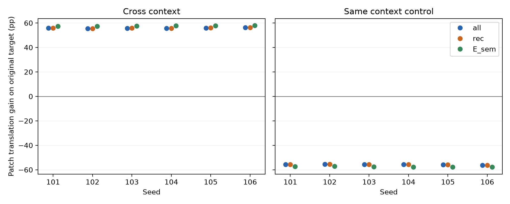
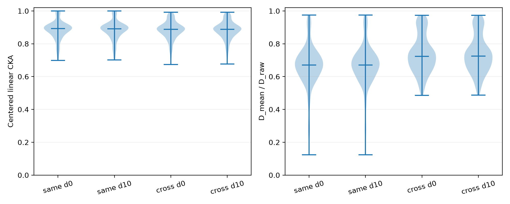
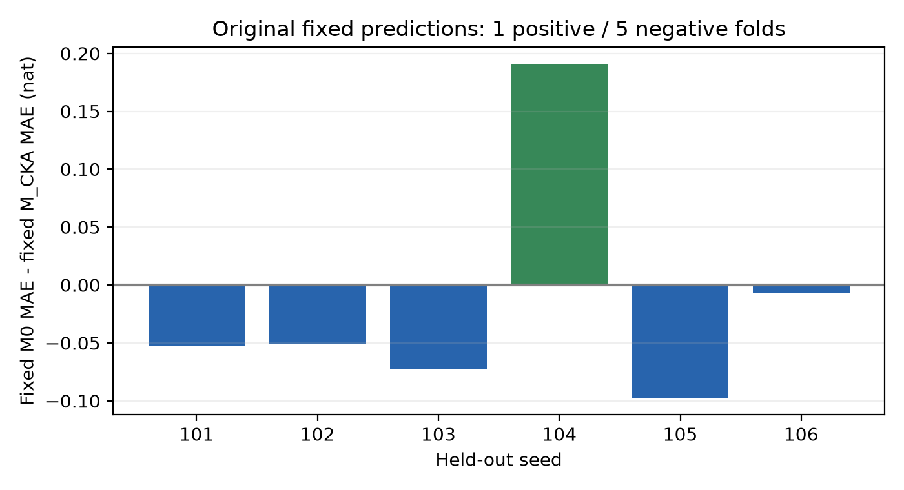

# v1.3 Final audit

日期：2026-10-12（America/Los_Angeles）。状态：**COMPLETED：三项有限复核完成，收口**。原六个 RNN 未再训练，旧 v1.3 点结果、主指标、全部 bootstrap、106 和数值核验失败记录均保留；没有发布或推送。

## 摘要

1. **内容匹配的干预优势保留。** 旧六模型等权原始 98.1683%、匹配 70.1305%、错误内容 19.0569%，匹配比错误内容高 51.0736 个百分点。这支持本设计中的内容相关干预优势，不证明 m 仅承载纯当前内容。
2. **原生 m 交换依赖规则上下文。** 旧同上下文平均新增错误约 1.697%，跨上下文约 53.398%；保留物理 c 组件不足以推断接收方的功能规则也被保留。
3. **供体规则解释得到新集合的行为确认。** B1 的三候选两两不同查询中，供体规则符合率 96.6383%。在独立 B_reserved 上，cross-context 的冻结主要准确率差为 **+55.7907 个百分点**；同上下文翻译对原目标的差为 -55.7907 个百分点。这里确认的是外部线索翻译对混合状态规则界面的补偿，与原直接交换成功不同。
4. **CKA 的原主检验仍为负，统计精度有限。** 固定六 fold 的平均 MAE 改善 -0.01489342 nat，1 正、5 负；条件经验区间 [-0.07402, 0.07351]。原重拟合 bootstrap 巨大区间保留，典型/极端副本复现且未发现本次检查范围内的实现错误。不能推出 CKA 永远不能预测功能。

## 冻结范围、独立确认与样本依赖

原 B 为 496 内容 / 70 轨道，已打开 B1 为 134 / 19；确切集合差为 **362 内容 / 51 完整轨道**。全部剩余轨道都使用，没有按 B1 结果抽选。冻结清单、成员、散列和旧自然状态缓存访问审计见 [B_reserved_manifest.json](B_reserved_manifest.json)、[成员 NPZ](B_reserved_members.npz)、[frozen_plan.json](frozen_plan.json)、[冻结回执](freeze_receipt.json)。保存的历史自然状态缓存没有这些剩余内容，未发现其先前用于规则选择或调参的记录；这项判断限于保留的本地记录，不声称可以重建未保存的外部访问。

六模型均来自原正式初始化和原选中检查点；T 仅用于固定探针拟合，G 仅用于几何。B1 新机制分析为 **EXPLORATORY**，B_reserved 为冻结翻译对比的独立确认，旧 CKA 主检验不被替代。

| seed | 原检查点（相对实验目录） | stage7 step | SHA256 |
| --- | --- | --- | --- |
| 101 | runs/v1_3/seed_101/selected_stage7.pt | 13500 | 7d2d1e3cf60c94e80c1bc254df633d2a5ec7b3a1e771c6016c969f95252081e2 |
| 102 | runs/v1_3/seed_102/selected_stage7.pt | 32500 | 53b5751a8728919042eb0f3660c6036bb6c68fa4a860d94fdf2108eea1fa7109 |
| 103 | runs/v1_3/seed_103/selected_stage7.pt | 16500 | 2f879d7b568faea91b164a3fa4f2367030572407fddf4f7deef3ccb328644cbd |
| 104 | runs/v1_3/seed_104/selected_stage7.pt | 21000 | dcf5e758c955846c917826596ff27da54da3bec740a8f2145d2fbf608ffffb99 |
| 105 | runs/v1_3/seed_105/selected_stage7.pt | 26000 | 19b33dfa65ff86b6f8b1c72680d6f84e0eccd011cde01f5fcc27ef4fe4f0c49b |
| 106 | runs/v1_3/seed_106/selected_stage7.pt | 23000 | 5ad670aff11654c7c82975d5cfa55cb1c4c18d2ce60a814b3a385f9c390642d8 |

覆盖所有 18 个 (r,H)、153 无序条件对的 306 个方向、d=0/10、S=NN/NA/NB、每个内容的 7 个项目和 7 个位置查询。主差按六种子等权，两个方向等权，原 d/S/query 分布不变，NN 也计入主要 S 混合。条件结果先在每个方向、d、S 的同一 mask 内按保留查询计算，再对这些单元等权；没有把每个查询当独立模型或独立统计样本。轨道/种子 bootstrap 保留方向、查询类型和整条轨道。

规则变化仅为新增第三反事实、A/B 后缀翻译、原生输出定义的 E_sem、G 均值分解、固定上下文探针、原 bootstrap 复播和固定预测描述。没有变更旧学习、门槛、主预测变量、alpha、方差地板或样本。完整规则见 [revision_final_audit.yaml](revision_final_audit.yaml)。

## 复核一：供体规则反事实与线索翻译

以供体 a、接收方 b、共同当前完整内容 q 为索引，三目标分别为：`Q_receiver=F_b(S)(q)`、`Q_initial=F_b(S)(G_b(p_a))`、`Q_donor_rule=F_a(S)(q)`。第三项没有与初始输入解释混写。错误内容 q′ 的候选为 `F_b(S)(q′)` 和 `F_a(S)(q′)`，没有为它虚构初始输入候选。B1 重用全部原匹配/错内容 log-probabilities；另独立生成并核验初始输入数学映射。

B1 跨上下文探索性结果（率为种子等权；数量汇总六种子，包含依赖查询）：

| 处理 | 候选可区分子集 | 查询数 | 接收规则 | 初始输入解释 | 供体规则 |
| --- | --- | --- | --- | --- | --- |
| matched | all | 10940832 | 45.2081% | 35.5153% | 98.1682% |
| matched | receiver_initial_distinct | 6414336 | 42.6286% | 26.0956% | 97.9649% |
| matched | receiver_donor_distinct | 6003072 | 0.9481% | 28.0260% | 97.4698% |
| matched | initial_donor_distinct | 7065984 | 38.8117% | 0.8494% | 97.8599% |
| matched | all_three_distinct | 2015232 | 0.9906% | 1.1680% | 96.6383% |
| wrong | all | 10940832 | 45.2081% | — | 98.1682% |
| wrong | receiver_donor_distinct | 6003072 | 0.9481% | — | 97.4698% |

全部同/跨上下文、每对候选可区分子集、三候选两两不同子集、查询类型与方向计数见 [候选总体表](candidate_overall_summary.csv)、[每种子表](candidate_seed_summary.csv)、各 `B1/seed_*/candidate_agreement.csv`。完整映射是否正确、是否双射、两个读出是否互为逆以及候选完整映射符合率见 [映射表](candidate_mapping_seed_summary.csv) 和每种子的 `mapping_agreement.csv`；每试次预测、全部候选与重合关系保存在 `counterfactual_d*_S*.npz`。

NN 的供体/接收规则完全重合；单操作时某些查询也重合，因此 all 的高符合率不能单独识别机制。错误内容 q′ 是固定双射重排：在固定 (a,b,d,S) 下，其候选符合率汇总可与匹配 q 的率完全相同，这不是额外独立证据。这里最有辨别力的是可区分子集与新增行为干预，不能由初始 p 可读性宣布 q 完全没更新。

翻译把 A/B 对换、N 保留。cross-context 时数学关系 `F_a(swap(S))(q)=F_b(S)(q)` 已对全部 5,040 个置换独立核验。每个状态都评价 native+S、native+swap(S)、匹配 m patch+S、匹配 m patch+swap(S)、sham。保留 **原语义目标** `F_b(S)(q)` 与 **新字面目标** `F_b(swap(S))(q)`；两者没有合并。

all/rec/both 沿用旧口径；E_sem 由 receiver native 原 S 正确、且 donor native 能执行相同语义运算定义：cross 用翻译 S，same 用原 S。所有六模型的原生输出和 masks 在任何新增 m patch 之前保存（[全模型回执](all_native_masks_frozen.json)）。原 visible-S 的 both 只要求各自在自身上下文中答对同一可见 S，与执行同一语义运算有区别。所有干预共享原 mask。

| 集合 | 上下文 | mask | 覆盖率 | 原 S 准确率 | 翻译 S 对原目标 | 差(pp) | CE 差(nat) | 新增错误差(pp) |
| --- | --- | --- | --- | --- | --- | --- | --- | --- |
| B1 | cross | all | 100.0000% | 45.2081% | 98.1682% | +52.9601 | -8.30775 | -51.6766 |
| B1 | cross | rec | 98.1683% | 45.2791% | 98.2435% | +52.9644 | -8.30163 | -52.9644 |
| B1 | cross | both | 96.3862% | 45.2571% | 98.4464% | +53.1893 | -8.35992 | -53.1893 |
| B1 | cross | E_sem | 96.4471% | 45.5504% | 99.9999% | +54.4495 | -8.32209 | -54.4495 |
| B1 | same | all | 100.0000% | 98.1682% | 45.2081% | -52.9600 | +8.30775 | +51.6966 |
| B1 | same | rec | 98.1683% | 98.2727% | 45.2834% | -52.9893 | +8.30280 | +52.9893 |
| B1 | same | both | 96.4714% | 99.9998% | 45.5525% | -54.4474 | +8.32236 | +54.4474 |
| B1 | same | E_sem | 96.4714% | 99.9998% | 45.5525% | -54.4474 | +8.32236 | +54.4474 |
| B_reserved | cross | all | 100.0000% | 42.0674% | 97.8582% | +55.7907 | -8.74779 | -54.2339 |
| B_reserved | cross | rec | 97.8582% | 42.1283% | 97.9453% | +55.8170 | -8.74363 | -55.8170 |
| B_reserved | cross | both | 95.7822% | 42.1169% | 98.1913% | +56.0744 | -8.80858 | -56.0744 |
| B_reserved | cross | E_sem | 95.8515% | 42.4285% | 99.9999% | +57.5715 | -8.76876 | -57.5715 |
| B_reserved | same | all | 100.0000% | 97.8581% | 42.0674% | -55.7907 | +8.74779 | +54.2530 |
| B_reserved | same | rec | 97.8582% | 97.9740% | 42.1320% | -55.8421 | +8.74586 | +55.8421 |
| B_reserved | same | both | 95.8746% | 99.9999% | 42.4297% | -57.5703 | +8.77030 | +57.5703 |
| B_reserved | same | E_sem | 95.8746% | 99.9999% | 42.4297% | -57.5703 | +8.77030 | +57.5703 |

新增错误沿用 native 原 S 正确且 patch 对原目标错误的定义；rec/E_sem 的表值是条件概率。CE 差与新增错误差为翻译减原 S，负值表示减少。覆盖率是原生输出决定的共同样本比例，两个处理不会各选一批试次。

B_reserved 冻结主要 all 对比的种子/轨道成对经验 95% 区间为 **[54.2157, 57.1861] 个百分点**。这是固定网络与本集合下的块重采样描述，不包括重新训练或未知模型总体的保证；所有 masks 区间见 [translation_block_intervals.json](translation_block_intervals.json)。

| seed | cross all(pp) | cross rec | cross both | cross E_sem | cross CE差 | cross新增错差(pp) | same all(pp) |
| --- | --- | --- | --- | --- | --- | --- | --- |
| 101 | +55.7619 | +55.7811 | +56.1333 | +57.3491 | -8.18071 | -54.2928 | -55.7619 |
| 102 | +55.4734 | +55.4293 | +55.7893 | +57.2161 | -8.97938 | -53.7575 | -55.4734 |
| 103 | +55.6982 | +55.7323 | +55.9838 | +57.5669 | -7.67756 | -54.0704 | -55.6982 |
| 104 | +55.6486 | +55.7116 | +55.9036 | +57.7697 | -8.24347 | -53.9203 | -55.6486 |
| 105 | +55.9283 | +55.9624 | +56.1802 | +57.6921 | -8.92589 | -54.4270 | -55.9283 |
| 106 | +56.2339 | +56.2854 | +56.4562 | +57.8350 | -10.47970 | -54.9353 | -56.2339 |

| S | patch 原目标 | 翻译后原目标 | 差(pp) | 原S供体规则 | 可区分查询供体规则 | 翻译后接收字面规则 | 翻译后供体规则 |
| --- | --- | --- | --- | --- | --- | --- | --- |
| NN | 99.2529% | 99.2529% | +0.0000 | 99.2529% | — | 99.2529% | 99.2529% |
| NA | 13.5746% | 97.3523% | +83.7777 | 96.9692% | 96.8651% | 13.3747% | 97.3523% |
| NB | 13.3747% | 96.9692% | +83.5945 | 97.3523% | 97.3174% | 13.5746% | 96.9692% |

NN 的原/翻译 patch log-probabilities **逐元素一致**，native/sham 也逐元素一致；B1 新翻译输出与原保存的对应 S′ 输出在原 GPU 登记容差内一致。NA/NB、两个 d、两个方向和全部 H/query 结果均保留，没有从中挑最好的一项。完整成对准确率/CE/新增错差、规则符合率与覆盖率见 [全部种子汇总](translation_seed_summary.csv)、[总体汇总](translation_overall_summary.csv)、各 `translation_d*_S*.csv`；全部 14 查询读出与候选保存在相应 NPZ，完整映射描述见 [translation_full_mapping_diagnostics.csv](translation_full_mapping_diagnostics.csv)。

B_reserved 原生质量及预定 native 翻译对照：

| seed | native 原任务 | native 翻译对原目标 | native 翻译对字面目标 | 原任务最差层 | 最差条件 | n |
| --- | --- | --- | --- | --- | --- | --- |
| 101 | 98.0182% | 42.2562% | 98.0182% | 81.9653% | r=0, H=BA, S=NB, d=10, type=1 | 2534 |
| 102 | 97.7122% | 42.2391% | 97.7122% | 88.3978% | r=1, H=AB, S=NA, d=0, type=1 | 2534 |
| 103 | 97.7208% | 42.0226% | 97.7208% | 83.1492% | r=1, H=AB, S=NA, d=10, type=1 | 2534 |
| 104 | 97.5672% | 41.9184% | 97.5672% | 81.1760% | r=0, H=AB, S=NA, d=10, type=1 | 2534 |
| 105 | 97.8902% | 41.9619% | 97.8902% | 85.1223% | r=1, H=AB, S=NA, d=10, type=0 | 2534 |
| 106 | 98.2404% | 42.0063% | 98.2404% | 63.0624% | r=1, H=AB, S=NA, d=10, type=1 | 2534 |

原生翻译主要符合新字面目标，而对原目标下降；因此翻译不是普遍提高网络准确率的处理。106 及其差条件完整保留。所有 native H×r×d×S×query 类型准确率与 CE 见 [native_all_strata.csv](native_all_strata.csv)，原生质量汇总见 [native_seed_summary.csv](native_seed_summary.csv)。

跨上下文翻译改善、同上下文翻译破坏原目标，并且 B1 可区分查询表现出高供体规则符合率，支持 **规则界面随 m 交换改变** 的解释。 这不证明 r 只在 m、c 完全无用，也不排除历史相关内容格式、初始输入、联合编码或最终一次性计算。新增处理包含外部语义翻译；不能写成原直接交换已经成功。

## 复核二：CKA、原生均值与上下文可读性

G 上几何统计去重到 (seed,condition_pair,d)，没有把相同值跨 S 的重复计为新样本，共 1,836 个值。

| 上下文 | d | n | min | q05 | q25 | median | q75 | q95 | max |
| --- | --- | --- | --- | --- | --- | --- | --- | --- | --- |
| same | 0 | 432 | 0.698615 | 0.759707 | 0.857789 | 0.891930 | 0.913618 | 0.998108 | 0.999986 |
| same | 10 | 432 | 0.702060 | 0.759483 | 0.857315 | 0.891830 | 0.913602 | 0.999881 | 0.999993 |
| cross | 0 | 486 | 0.672997 | 0.768475 | 0.856044 | 0.888664 | 0.912799 | 0.974673 | 0.992563 |
| cross | 10 | 486 | 0.676044 | 0.769509 | 0.854386 | 0.888701 | 0.913299 | 0.974789 | 0.992786 |

原固定规则选出的全部 288 个高 CKA/高新增错案例都列在 [original_fixed_counterexamples.csv](original_fixed_counterexamples.csv)，保留实际 CKA、原分位数门槛、新增错误、native/pair 质量、方向最差 query 类型质量和均值分解。分位数高不自动等于 CKA 接近 1；这是预先固定规则的案例清单，不是挑某个看起来漂亮的交换。

以下仅显示原保存顺序的前八行；没有按新增复核结果重选，完整 288 行见链接：

| seed | (a,b) | d | S | 实际 CKA | native(pair) | 最差方向/type native | 新增错误 R |
| --- | --- | --- | --- | --- | --- | --- | --- |
| 101 | (7,17) | 0 | NN | 0.971889 | 99.0938% | 98.9339% | 0.6930% |
| 101 | (8,16) | 0 | NN | 0.956281 | 98.3742% | 97.8678% | 1.2527% |
| 101 | (0,9) | 0 | NA | 0.988387 | 99.7868% | 99.5736% | 82.0629% |
| 101 | (3,11) | 0 | NA | 0.961657 | 99.2271% | 98.6141% | 81.6098% |
| 101 | (4,11) | 0 | NA | 0.962153 | 99.2271% | 98.6141% | 81.6098% |
| 101 | (5,9) | 0 | NA | 0.975455 | 99.4936% | 99.1471% | 81.9829% |
| 101 | (6,9) | 0 | NA | 0.965994 | 99.1205% | 97.7612% | 81.6365% |
| 101 | (12,14) | 0 | NA | 0.928670 | 98.2143% | 96.9083% | 1.7324% |

原生坐标均值分解使用原 D_raw 的同一分母：`D_mean=||mu_a-mu_b||²/den`，`D_center=mean_q||(m_a-mu_a)-(m_b-mu_b)||²/den`。没有对干预状态平移、旋转或标准化。独立计算逐项验证 `D_raw=D_mean+D_center`，最大绝对误差 7.77e-16。完整值与分母见 [geometry_decomposition.csv](geometry_decomposition.csv)。

| 上下文 | d | D_raw 中位数 | D_mean 中位数 | D_center 中位数 | D_mean/D_raw 中位数 |
| --- | --- | --- | --- | --- | --- |
| same | 0 | 1.2409 | 0.832682 | 0.374766 | 0.670441 |
| same | 10 | 1.23457 | 0.837089 | 0.375992 | 0.670513 |
| cross | 0 | 1.33554 | 0.964595 | 0.388655 | 0.723725 |
| cross | 10 | 1.32662 | 0.957122 | 0.386523 | 0.72427 |

中心化消去所有 q 共享的平移，是数学事实：若 `m_b(q)=m_a(q)+v`，中心化线性 CKA=1，v 仍可能影响未来 A/B 的解释。独立合成检验得到 CKA≈1。这只是可能机制；真实 RNN 的 D_center 不为零，不能说网络只是相差一个平移。原保留未中心化信息的 D_raw 在旧主留出检验同样没有稳定改善（M_raw MAE 约 2.69497 nat，M0 2.68475）。这些分解是描述，未临时替换主预测变量。

上下文探针为固定线性 ridge，alpha=1、r→±1、阈值 0，仅用 T 原 512 内容自然状态拟合，r/H/d 平衡，排除 AB/BA 作历史留出。只用 T 拟合坐标中心与标准差；仅“精确为零”的标准差置 1。m 每条件内容等权；c 不把重复 q 当独立状态：pooled 拟合为 28 个 (r,H,d)，单 d 为 14 个，实际独特向量数另存。pooled、fit-d0、fit-d10 全部固定展示，未按分数选择方向或更复杂探针。

G AB/BA 历史/内容留出上的 pooled 探针：

| seed | m d0 | m d10 | c d0 | c d10 | m 边际 d0 | m 边际 d10 | c 边际 d0 | c 边际 d10 |
| --- | --- | --- | --- | --- | --- | --- | --- | --- |
| 101 | 100.0000% | 100.0000% | 50.0000% | 50.0000% | 0.655663 | 0.646789 | 0 | 0 |
| 102 | 100.0000% | 100.0000% | 50.0000% | 50.0000% | 0.839875 | 0.852983 | -5.18397e-11 | 0 |
| 103 | 75.0000% | 75.0000% | 50.0000% | 50.0000% | 0.515704 | 0.504857 | 0 | 0 |
| 104 | 100.0000% | 100.0000% | 50.0000% | 50.0000% | 0.761336 | 0.763045 | 0 | 0 |
| 105 | 98.7297% | 98.8821% | 50.0000% | 50.0000% | 0.813203 | 0.813379 | 0 | 0 |
| 106 | 86.2805% | 85.9248% | 50.0000% | 50.0000% | 0.659651 | 0.653723 | 2.52056e-11 | 0 |

| seed | c 独立拟合数 | c 精确独特向量数 | c raw差 L2 min | c raw差 L2 max | m raw差 L2 min | m raw差 L2 max | c 最小非零 T std |
| --- | --- | --- | --- | --- | --- | --- | --- |
| 101 | 28 | 8 | 0 | 0 | 3.32556 | 6.87996 | 2.735738043515572e-07 |
| 102 | 28 | 21 | 0 | 6.20247e-07 | 4.46476 | 7.64141 | 0.0007883686603691337 |
| 103 | 28 | 9 | 0 | 0 | 4.27202 | 7.25293 | 5.293840577035602e-07 |
| 104 | 28 | 10 | 0 | 0 | 5.12643 | 7.55172 | 3.382160888705043e-05 |
| 105 | 28 | 7 | 0 | 0 | 4.47785 | 6.79545 | 5.902125266736281e-06 |
| 106 | 28 | 15 | 0 | 9.11086e-07 | 3.14669 | 7.63425 | 0.0017138775762968641 |

完整 T/G、同/不同 d、非混合/AB/BA、每个 H 的边际和准确率见 [context_probe_results.csv](context_probe_results.csv)，raw L2 见 [context_raw_contrasts.csv](context_raw_contrasts.csv)，独特状态数量与标准差见 [context_probe_fit_inventory.csv](context_probe_fit_inventory.csv)。拟合参数和每个自然状态的分数、边际、标签均保存在 `context_probes/seed_*/`。标准化可以放大很微小的残留，边际大小不能直接作为神经功能贡献。

m 中 r 可读性及线索翻译与规则界面解释一致；c 的此固定 AB/BA 探针处于机会水平不能证明 c 无任何信息或因果作用。解码 r 不等于网络因果使用 r，c 可探到某些信号也不证明它控制未来规则。几何、probe、语义翻译补偿均为这组人工网络的证据，不能直接推断真实脑机制；正确原始行为也不排除历史记在 m、末尾一次性算答案。

## 复核三：重拟合不稳定与固定预测点结果

原主检验 M0_v13 MAE=2.6847533452 nat，M_CKA_v13=2.6996467606 nat；加入 CKA 的均值改善为负。原 refit bootstrap MAE 改善 95% 区间 **[−42.55952, 87.77731] nat**、RMSE 改善区间 **[−172.43769, 320.18672] nat** 全部保留。这些区间很宽，不能视为有足够精度，也不能当成 CKA 普遍无效的证据。

复播副本 0, 164, 285, 991（原数据定义的典型 164，最低 991、最高 285 MAE 改善，加原 0/285），共 72 个 all/rec/both×留出模型×M0/CKA 拟合。留出原种子的所有复制整体排除；每个模型权重、独特训练模型数、每个特征的 mean/scale/raw 范围/test z 范围、ridge 系数、最大预测、对应条件与有限性均保存。配对 M0/CKA 的训练标签及单位散列一致。复播 MAE 与原保存值最大差为 0。

副本 285 的留出 106 拟合样本为原种子 `[101,101,105]`，仅两个独特模型；控制距离近恒定，使测试 z-score 极端外推。已复现最大 |z| 342629.284376，最大 |预测| 87359.894091 nat，预测仍全部有限。没有发现种子副本泄漏或不成对重采样；数值外推本身不是自动的实现 bug。没有删 106、裁剪预测、改 alpha 或提高方差地板。全部记录见 [bootstrap_replay_metadata.json](bootstrap_replay_metadata.json)、[每特征表](bootstrap_feature_diagnostics.csv)、[复播分数](bootstrap_replay_scores.csv)、原 [bootstrap 副本](../results/v1_3/prediction/bootstrap.csv)。

| rep285 held106 | 拟合模型权重 | control 原训练范围 | 原训练 std / scale | 原测试范围 | max |test z| | max |预测| nat |
| --- | --- | --- | --- | --- | --- | --- |
| M0_v13 | 101×2,105×1 | [0, 3.21e-06] | 9.06e-07 / 9.06e-07 | [0, 0.31] | 342629 | 87359.9 |
| M_CKA_v13 | 101×2,105×1 | [0, 3.21e-06] | 9.06e-07 / 9.06e-07 | [0, 0.31] | 342629 | 38877.5 |

| 留出种子 | M0 MAE | M_CKA MAE | 成对 MAE 改善(nat) | 成对 RMSE 改善 |
| --- | --- | --- | --- | --- |
| 101 | 2.46463021 | 2.51708897 | -0.05245876 | -0.06394987 |
| 102 | 2.44208739 | 2.49270992 | -0.05062253 | -0.02285060 |
| 103 | 1.95262642 | 2.02569391 | -0.07306750 | -0.06176421 |
| 104 | 2.85718927 | 2.66600606 | +0.19118321 | +0.04457927 |
| 105 | 2.42507087 | 2.52251304 | -0.09744217 | -0.09385756 |
| 106 | 3.96691592 | 3.97386867 | -0.00695275 | +0.01219553 |

固定预测点结果：均值 -0.01489342 nat，范围 [-0.09744217, +0.19118321]，仅 104 正、其余 5 负。六个已观察 fold score 成对重采样 100,000 次所得条件经验区间为 [-0.07401677, 0.07351177] nat。它条件于这六个已训练模型/预测器和原测试数据；没有重拟合，没有重新训练，不包括未知模型总体或训练不确定性，不替代原 refit bootstrap。见 [fixed_prediction_summary.json](fixed_prediction_summary.json)。

“重拟合算法在退化拟合集上不稳定”与“固定预测平均未改善”是两个结果。在本设计、既定基线和原留出条件下，没有观察到稳定的 CKA 增量预测收益；不能宣称 CKA 永远无法预测功能。

## 数值核验、预算与停止

原数值注记继续保留：**GPU 登记对照通过；CPU float32 原严格 logit 容差未通过；同一系数的 float64 一致、原比较 argmax 不变。** COMPLETED 表示有限实验/复核完成，不表示所有精度核验通过。新 GPU 原生缓存/不间断计算按原 atol=rtol=1e−5 通过、argmax 未变、sham 与 NN 精确一致；未用新宽容差抹掉旧 CPU 失败。

继承 GPU 保守记账 3313.147 秒。收尾后累计 **4043.451 秒（1.1232 GPU 小时）**，上限 12 小时；新复核登记 730.304 秒。成本口径和原始计时见 [budget.json](budget.json)。原始检查点、源代码、曲线、主预测、全部 bootstrap 的散列验证见 [preservation_check.json](preservation_check.json)。

复现命令与产物索引见 [README.md](README.md)，复核源代码在 [final_audit/](../final_audit/)，规则与成员冻结文件均在本目录；[artifact_manifest.json](artifact_manifest.json) 登记全部新产物散列。所有六种子输出都交付。完成这三项后停止：没有新模型、参数扫描、适配器、神经元消融或四步序列扩展，负结果亦保留。

## 可导出的图

每图同时提供 PDF/SVG。
