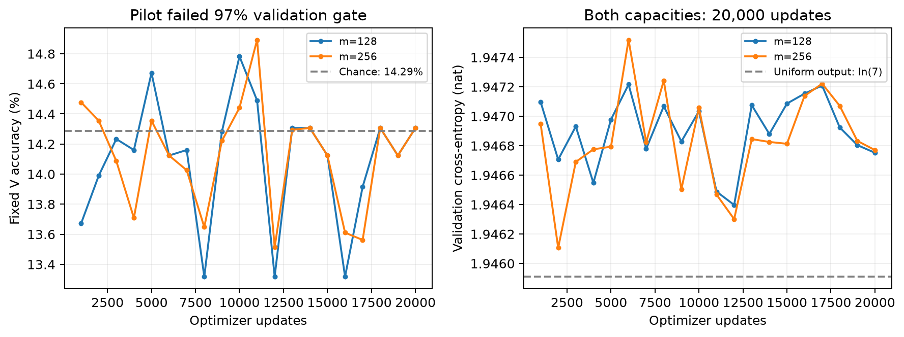
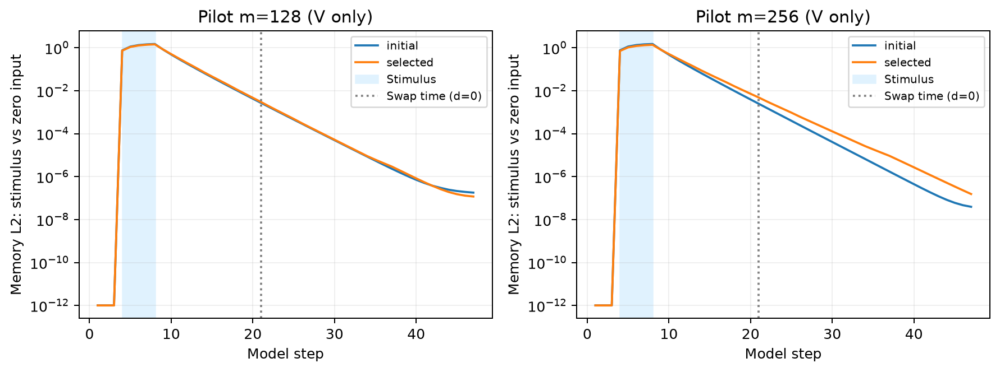

# 执行报告：BLOCKED

日期：2026-10-12（America/Los_Angeles）。方案 v1.0。

研究问题：相同完整记忆内容、不同形成历史的候选记忆状态，其几何相似度能否预测保留接收方控制状态后的功能可互换性？

本目录是独立实验实现；没有修改既有实验或论文结论，没有推送或发布。

## 实际完成范围与门槛

| 项目 | 状态 |
|---|---|
| 数组真值与独立矩阵评价；n=6/7 轨道复核 | 通过 |
| 轨道级 T/V/G/B 划分、内容匹配和时间检查 | 通过 |
| 控制模块不接收置换或 m；状态缓存内容隔离 | 通过 |
| sham、全状态与不中断续跑实现对照 | 通过 |
| float64 CKA 双公式、尺度/同行重排与已知矩阵测试 | 通过 |
| LOSO/历史标签隔离与折内缺失值处理 | 合成数据实现测试通过；不是研究结果 |
| GPU | NVIDIA GeForce RTX 5070 |

独立复核：S₇ 的 5,040 个置换形成 694 条轨道；S₆ 为 115 条。轨道大小为 2、4 或 8。

65 个训练词覆盖 7 种净变换；16 个四 A/B 测试词全部是新序列，仅 ABAB、BABA 引入第 8 种净变换。这是数据生成的数学性质，不说明网络学会群结构。

| 集合 | 轨道数 | 置换数 |
|---|---:|---:|
| T | 451 | 3274 |
| V | 104 | 778 |
| G | 69 | 492 |
| B | 70 | 496 |

正式行为子集预先固定为 134 个置换、19 条完整轨道；其余 B 内容保留。

split_seed=20261012；按规范化轨道列表打乱，T/V/G 向下取整，余数归 B。文件 SHA-256：`a53ec093b315c53fd7b6066ff5ca5c17508195d3035b85c37cb2ccec7448ef8c`。

所有输入在刺激阶段结束后均不再提供置换；查询在交换时点之后才出现。网络仅使用最终查询交叉熵，未接受中间监督、交换训练或几何损失。

## Pilot：原任务先于科学分析

| memory_dim | 更新数 | 最佳步数 | 固定 V 准确率 | V CE (nat) | 训练秒数 | 峰值 torch 分配显存 (MiB) | ≥97% |
|---:|---:|---:|---:|---:|---:|---:|---|
| 128 | 20000 | 10000 | 14.7827% | 1.947035 | 123.054 | 310.56 | 未通过 |
| 256 | 20000 | 11000 | 14.8926% | 1.946468 | 171.986 | 233.94 | 未通过 |

pilot seed=0；同一固定验证集包含 8,192 个试次。检查点只按验证准确率、再按交叉熵选择；没有根据交换结果选择容量或随机种子。

每种容量完整运行 20,000 次 Adam 更新；未进行额外容量、初始化、课程训练或超参数搜索。

默认与唯一备用配置均未达到原任务门槛，已按方案第十二/十三节停止正式运行。

**H1 无有效结论；H2、H3 未检验。没有正式 G/B 状态测量，没有正式六种子标签、预测误差、显著性或科学反例。**

正式种子 101、102、103、104、105、106 均未运行，原因相同：pilot 任务学习失败。

## 失败诊断：仅使用 V

机会水平为 1/7=14.2857%；均匀输出交叉熵 ln(7)=1.945910 nat。两种配置的验证结果接近此水平。参数确实更新，梯度有限；失败不等于优化器没有执行。

| memory_dim | 移除刺激后回答改变率 | 打乱刺激后回答改变率 | 移除刺激最大 logit 差 | 第 8 步内容影响 L2 | 第 37 步内容影响 L2 |
|---:|---:|---:|---:|---:|---:|
| 128 | 0.0000% | 0.0000% | 2.98e-08 | 1.43708 | 2.93999e-06 |
| 256 | 0.0000% | 0.0000% | 1.49e-07 | 1.38056 | 9.29054e-06 |

此处内容影响是同一 V 试次、控制输入完全相同时，原始刺激与全零刺激对应 m 的 L2 差。第 8 步是刺激结束，第 37 步是 d=0 的最终查询。最终输出对初始内容几乎不敏感，和内容信息在保持/更新期间衰减的解释相符；这项诊断不能单独确定因果性的训练失败机制。

V 的前 52 条轨道用于几何速度和探针诊断（392 个内容）；后半部分的前若干完整轨道用于干预诊断（34 个内容、6 条轨道）。两部分轨道不相交。探针只在 T 上拟合 alpha=1 ridge；没有用 V/G/B 拟合。

| memory_dim | sham 最大 logp 误差 | 全状态最大 logp 误差 | V 干预最差原始层准确率 | V 探针逐项目准确率 | V 探针完整置换准确率 |
|---:|---:|---:|---:|---:|---:|
| 128 | 0 | 2.38e-07 | 20.1681% | 12.4544% | 0.0000% |
| 256 | 0 | 2.38e-07 | 19.3277% | 13.0892% | 0.0000% |

上述缓存包含自然形成状态、逐槽真值轨迹、供体初始置换，以及全部查询的原始/sham/匹配/错误内容/同上下文全状态输出。错误内容来自固定跨轨道无自匹配置换，记录接收方答案与供体反事实答案。全部原始数据均保留，但只作实现诊断。

**诊断中的匹配与错误内容替换表现相同；新增错误接近零、概率损害极小不能称为学会内容后的兼容性上限效应。原网络已经无法完成任务，没有辨识 H1/H2/H3 的条件。**

未计算 pilot 的相似度—损害相关系数或预测模型；未挑选高 CKA 反例。原任务未通过，所以四步未见词扩展也未运行。

## 计算成本与进入正式运行的决定

- 128 维：训练约 162.5 更新/秒；完整 V 干预评价 3.915 秒（约 223232 个主匹配查询/秒，实际计时还含其他对照及保存），V 几何/初始化/探针诊断 2.543 秒。两种评价峰值 torch 分配显存分别为 692.91/198.15 MiB。按内容数线性外推并为每个正式种子保留 120 秒几何余量，六种子训练与主评价估计 0.431 GPU 小时；不含 CPU bootstrap 与文件写入的机器差异。
- 256 维：训练约 116.3 更新/秒；完整 V 干预评价 3.846 秒（约 227262 个主匹配查询/秒，实际计时还含其他对照及保存），V 几何/初始化/探针诊断 4.821 秒。两种评价峰值 torch 分配显存分别为 489.07/149.84 MiB。按内容数线性外推并为每个正式种子保留 120 秒几何余量，六种子训练与主评价估计 0.512 GPU 小时；不含 CPU bootstrap 与文件写入的机器差异。

上述估算只检验预算可行性；原任务门槛失败已经足以阻止正式运行。GPU 条件与预算不是本轮阻塞原因。

累计 GPU 操作墙钟记账：337.979 秒（0.0939 小时），预算上限 12 小时。记账包含训练、验证、缓存及 GPU 诊断的外围开销；曾短暂重叠的训练/诊断时间各自记账，因此是保守成本估计。

## 可复现产物与限制

- `config.yaml`、`split_manifest.json` 与 `results/frozen_plan.json` 保存方案、轨道、固定 B 子集和源码散列。
- `runs/pilot_128/`、`runs/pilot_256/` 各含 `initial.pt`、`best.pt`、`latest.pt`、训练曲线、完整优化器和可恢复 Python/NumPy/Torch/CUDA 随机数状态。
- `analysis/raw_d*_S*.npz` 按供体、接收方、内容、查询类型、查询项目保存输出与真值；`orbit_blocks.npz` 保存每条轨道、每个方向与查询类型的统计和查询计数。
- `directions.csv`、`native_strata.csv`、`labels.csv` 保留方向/上下文/S/d 分层。原始数据足以重算指标，不能把共享状态的查询当成独立 CKA 样本。
- 预测实现固定 alpha=1 ridge。外层留出模型种子，拟合只用 91 个不涉及 AB/BA 的配对；未见 62 对含跨上下文 32 对。同一代码包含训练折内预处理、初始化 CKA 检查及种子/行为轨道层级重采样。实现测试使用合成数据，其数值未写作研究结果。

候选 m/c 模块由架构预先指定；单向控制并不能证明天然的独立记忆脑区。数学任务的精确内容标签不等于网络学会代数结构，也不能外推真实神经系统。

本轮没有检索更新相关工作或判断原创性。方案中的文献链接仅作原始定位，论文提交前仍需核对版本与近邻工作。

**最终状态：BLOCKED。**
